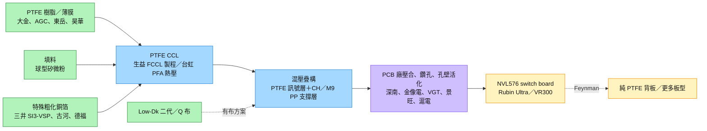
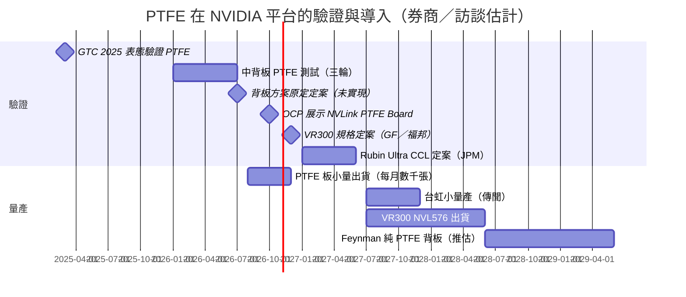

# 技術_PTFE

## 定義

PTFE（Polytetrafluoroethylene，聚四氟乙烯，俗稱鐵氟龍）是氟原子均勻包覆碳主鏈的對稱高分子，幾乎沒有淨極性，10 GHz 下 Dk 約 2.1、Df 約 0.0002–0.0003，是 CCL 常用樹脂中損耗最低的一種，優於 PPO／PPE 與碳氫（HC）樹脂。它和一般高速 CCL 的差別在於：Epoxy、PPO、HC 都是熱固性樹脂，加熱後交聯固化；PTFE 是熱塑性材料，不交聯、偏軟、表面能低，所以電性最好但最難加工。PTFE 在射頻、毫米波雷達、衛星天線與軍工板材已用了十多年，但過去都是低層數板。

現在重要，是因為 NVIDIA 的 scale-up 互連往 224G／448G SerDes 推進，Rubin Ultra 的 NVL576（8 櫃）switch board 與背板損耗目標約 Df ≤0.0004，M9／M10 碳氫材料多數樣品只做到 0.00043–0.00045。PTFE 被視為延長銅互連壽命的材料解方：NVIDIA 在 GTC 2025 就表達過驗證意圖，並於 OCP 2026 首度展示 NVLink PTFE Board 與 7 家供應商。PTFE 的核心問題已從「電性夠不夠」變成「高層數板能不能穩定量產」，因此混壓（hybrid）結構、良率與壓合設備成為投資觀察重點。

PTFE 屬於 [[技術_CCL]] 的樹脂路線分支，會牽動 [[技術_Q布]]（需求可能被部分取代）、[[技術_HVLP銅箔]]（需特殊粗化處理）、[[技術_正交背板]] 與 [[技術_PCB鑽孔設備]] 的規格；所屬供應鏈主軸為 [[供應鏈_AI伺服器PCB]]。

## 圖解

![[報告_GF_PTFE導入_20261015_001.png]]

圖說：NVIDIA 在 OCP Global Summit 2026 首度展示的 NVLink PTFE Board，下方列出 7 家合作夥伴（VGT、TTM、Taiflex、SYTECH、SCC、Kinwong、Flexium）。這是 PTFE 從研究機構傳聞轉為 NVIDIA 公開驗證方向的關鍵事件，但展示不等於 Rubin Ultra 已定案採用。（來源：OCP 2026，GF 2026-10-15 轉載）

![[JPM_PCB__CCL_and_Substra_2026-09-01_5431668(1)_002.png]]

圖說：JPM 整理的 CCL 樹脂路線最佳 Df 值：M9 約 0.00065，M10（有布／無布）約 0.00042–0.00044，仍略高於 0.0004 目標；M10 無布＋有布 PTFE 混壓、PTFE 有布、PTFE 無布才落入目標區。這解釋了為何 NVL576 switch board 的討論會收斂到 PTFE。（來源：JPM 2026-09-01，estimate）

![[JPM_PCB__CCL_and_Substra_2026-09-01_5431668(1)_001.png]]

圖說：JPM 的 NVIDIA CCL 樹脂遷移路徑：由「M10 有布」往「PTFE 無布」，電性逐步變好，但機械支撐、鑽孔加工性與散熱都逐步變差；Rubin Ultra NVL576 switch tray 對應中間的「M10 無布＋PTFE 有布」，Feynman NVL576 switch tray／背板才可能走到純 PTFE。

圖說：PTFE 供應鏈從樹脂、填料、銅箔到 CCL 與 PCB 製程都需重新認證；目前量產設計是 PTFE 只負責訊號層、其餘層由 CH／M9 材料提供支撐，純 PTFE 是 Feynman 以後的目標。

## 技術原理

| 模組 | 功能 | 觀察重點 |
|---|---|---|
| 樹脂分子結構 | 低極性、對稱結構決定 Dk／Df | 演進順序為 Epoxy（FR-4～M4）→ PPO／PPE → 碳氫（M7 起混入、M9 幾乎全為 HC）→ PTFE；C–F 鍵能約 460.5 kJ/mol，帶來化學穩定性與耐熱性 |
| 熱塑性 vs 熱固性 | 決定能否承受多次壓合與 PCBA | PTFE 不交聯、偏軟，多次壓合易變形；需極高溫、真空或惰性氣氛與更長壓合週期，或用 PFA／熱固性黏結層 |
| CTE 與尺寸安定性 | 高層數對位 | PTFE CTE 約 100–200+ ppm/°C，玻布或球型矽微粉僅約 0.4–0.6；超過約 50 層時層間偏位難以控制 |
| 填料 | 降 CTE、補機械性 | 填料越多電性越差、鑽孔掉屑越多；方向是中空矽粉或更細顆粒，但高黏度 PTFE 漿料分散困難 |
| 銅箔附著 | 剝離強度 | PTFE 表面能低，需樹脂改性加極性官能團，或用「珊瑚／絨毛狀」粗化銅箔嵌入 PTFE；三井為主流 |
| 鑽孔與孔壁 | 層間導通 | 軟、黏、易膠渣與毛邊；孔壁需鈉蝕刻或電漿活化才能化學鍍銅；雷射鑽孔需高能量，易碳化產生碳粉微短路 |
| 混壓疊構 | 兼顧電性與量產 | PTFE 當訊號層、M9／CH PP 當支撐層；比例說法有約 3:7（生益訪談）、32 層中 8–12 層（GF）等 |

與一般高速 CCL 的差異：M6～M10 的升級主要靠樹脂配方、玻布（Low-Dk 二代、Q 布）與銅箔粗糙度逐級改善，PCB 製程大致沿用；PTFE 則是換掉整個樹脂體系，PCB 廠的壓合、鑽孔、除膠渣與孔壁處理都要重做，還需要高溫壓合機（德國 Lauffer 等，交期已由半年拉長到 1–1.5 年）。所以 PTFE 的門檻不在 CCL 本身，而在 CCL 廠與 PCB 廠能否共同做出可接受的良率。

### 三種 PTFE 方案（福邦整理）

![[報告_福邦_2026Q4_PCB產業_20260921_p29.png]]

圖說：福邦整理的三種 PTFE 疊構：①PTFE CCL（無布）＋CH PP（有布，Low-Dk 4／二代 Q）電性優於 M10、加工性最佳，PCB 良率約 30%，屬備案；②PTFE CCL（無布）＋CH PP（無布）是供應鏈目前積極測試的方案；③PTFE CCL＋PTFE PP（全無布）電性最佳、加工性最差，是最終目標。②③的 PCB 良率約 10–30%。CCL 端走 FCCL 製程（生益 SG5300N 塗佈＋熱壓、台虹熱壓法），銅箔為三井 SI3-VSP（HVLP4／5）。（來源：福邦投顧 2026Q4 PCB 產業報告第 29 頁，產業調研）

![[報告_福邦_2026Q4_PCB產業_20260921_p30.png]]

圖說：有布與無布的取捨。PTFE 搭配電子布會拉高 Dk／Df（Low-Dk 布 Dk 4.6–4.8、Df 0.002–0.003），但 PTFE 的 CTE 達 100–200+ ppm/°C；需放晶片的 UBB、compute、switch、motherboard 仍需有布確保尺寸安定，只走訊號的板才適合無布＋矽微粉填料。（來源：福邦第 30 頁）

![[報告_MorganStanley_AI隱形基礎建設_20260913_p29.png]]

圖說：台虹的 PTFE CCL 疊構為銅箔 1/3–1/2 oz 夾 5–30 mil PTFE、無玻纖、超低 Df，屬上表的無布 PTFE CCL 層，需搭配 PP 才能組成多層板。（來源：台虹，MS 2026-09-13 轉載）

> [!note] 台虹 PFA 與生益純氟樹脂的路線差異
> 生益訪談（AceCamp 2026-09-08）稱台虹採 PFA 氟膜（東麗／三菱開發，後由旭硝子量產），以 PI 膜夾在兩層 PFA 之間提供支撐，再與銅箔五層滾壓；生益則以純氟系樹脂混填料直接與銅箔層壓。SemiAnalysis 說明 PFA 兼具 PTFE 的耐化學與熱穩定性，又能熔融加工。此為匿名訪談與研究機構說法，信心中。

## 關鍵參數 / 判斷指標

| 指標 | 意義 | 投資觀察 |
|---|---|---|
| Df（10 GHz） | 介電損耗 | 目標約 ≤0.0004；PTFE 約 0.0002–0.0004、M10 約 0.00042–0.00045。M10 若能達標，PTFE 必要性下降，對台光電、台燿等 HC 路線有利 |
| PCB 量產良率 | 有效供給 | 福邦估 10–30%，JPM 認為到 2027 年底量產時仍可能低於 50%；良率越低，CCL 用量越高（JPM：材料市場可能大於帳面 TAM） |
| PTFE 層數占比 | CCL 價值分配 | GF 估 32 層中 8–12 層為 PTFE，占 CCL 樹脂價值不到 50%；占比越高，對 M9／PPO／HC 樹脂的替代越大 |
| 有布 vs 無布 | 電性與加工的取捨 | 無布對 Q 布、二代布需求不利；有布方案仍可用二代布或 NER 布（JPM 認為日東紡受影響有限） |
| 高溫壓合機產能 | 擴產瓶頸 | 交期 1–1.5 年；JPM 認為缺高溫壓合機是混壓優於純 PTFE 的原因之一 |
| 銅箔剝離強度 | 可靠度 | 需特殊粗化銅箔，三井為主流；回流焊爆板仍是無布方案主要障礙（台光電訪談） |
| CCL 價格 | 價值量 | 生益訪談：PTFE 板材約 RMB 1,500–2,500／㎡；2026-05 訪談稱約 1,600 元／㎡、純 M9 >7,000 元／㎡；JPM：無布 ASP 低 20%+，但毛利約 60%（一般約 50%） |
| 規格定案時點 | 催化劑 | GF／福邦估 2026 年底 VR300 設計定案；JPM 估 Rubin Ultra CCL 規格 1Q／2Q27 定案 |

## 產業動能

- **NVIDIA 公開展示**：OCP Global Summit 2026（10 月中）首度展示 NVLink PTFE Board 與 7 家夥伴；MS 認為名單有缺，[[2368_金像電（市）]]、[[3037_欣興（市）]] 也在開發，深南、金像電、VGT 良率相對領先（[[261019_ms_OCP-MGX]]，2026-10-19）。GF 認為這強化了 PTFE 混壓是 VR300 NVL576 switch board 最可能方案的看法（[[報告_GF_PTFE導入_20261015]]，2026-10-15）。
- **Kyber 延後後回到 Oberon**：MS 指 NVIDIA 原規劃 Kyber 超高層 midplane 用 PTFE，Kyber 延後後改評估 Rubin Ultra（Oberon）switch tray，midplane 與小板目前未見轉 PTFE（[[報告_MorganStanley_AI隱形基礎建設_20260913]]，2026-09-13）。SemiAnalysis 指目標板為 Portia（NVSwitch 7），生益已投入逾 12 個月、WUS（金像電）已交 PTFE PCB 樣品（[[報告_SemiAnalysis_PTFE延伸銅互連_20260820]]，2026-08-20）。
- **NVL576 才用，單櫃 NVL72 仍是 M8**：JPM 認為 M10／PTFE 混壓用於 NVL576 switch tray，單櫃格式即使到 Rubin Ultra 仍為 M8；Feynman 才可能用全 PTFE（[[JPM_PCB__CCL_and_Substra_2026-09-01_5431668(1)]]，2026-09-01）。
- **驗證歷程**：生益訪談稱 2026-01 起中背板測試 PTFE，4 月有布 PTFE 因雷射鑽孔掉屑被否決，無布 PTFE 疊高後剝離，6 月第三輪改為有布板與 PTFE 混壓，可做到 50 層以上；8 月 PTFE 板月出貨僅數千張，4Q26 起訂單密集下達但交期分散在 6–9 個月（[[memo_AceCamp_生益科技PTFE混壓CCL_20260908]]，2026-09-08）。
- **客戶偏好無布，但爆板未解**：台光電相關訪談稱客戶極力推動 PTFE 無布方案，但回流焊持續爆板；M9＋二代布＋PTFE 的可行性高於無布 PTFE 與 M10（[[memo_AceCamp_台光電_CCL與PTFE_20260901]]，2026-09-01）。
- **PCB 價值量上修**：GF 估 PCB 價值由 GB300 每 GPU 約 US$440、VR200 約 US$750，到 VR300 約 US$1,000；若 NVL576 採 PTFE，可超過 US$1,500（[[GF - PCB- Content Upside & PTFE Adoption 20260909]]，2026-09-09）。
- **HC 無布路線競爭**：GF 2026-10-05 提到市場有聲音認為 VR300 NVL576 switch tray 會改用 HC 樹脂；GF 認為 HC 剛通過 SI 測試、落後 PTFE 約三個月，仍看好 PTFE 混壓（[[報告_GF_科技產業10月版_20261015]]，2026-10-15）。
- **產業交流筆記（2026-10-22）**：NV PTFE 無布化路線由北美決定、亞洲配合；生益 PTFE CCL 已過、台虹做 PP，生益＋台虹搭配為 NV 指定（雙方有既有軟性銅箔基板產能可沿用）；聯茂有出 PP、南亞也可能跟進。全 PTFE 目前只有深南良率較好（高溫壓機、燒結製程），正交背板 78 層＝3 張 26 層串接、組裝良率約 70%；ultra switch tray 與正交目前沒有非 PTFE 選項，M10 也不行。非中 PTFE 尚有 Rogers 但產能少；北美約 3 成資料中心需求要求非中產能。台系 NV 體系 PCB 以欣興為主，筆記稱只有金像電跟上陸廠對位技術（但不在 NV 體系）、台郡 10 台高溫壓合機受設備限制。路線上 compute tray 走有布碳氫（HC），無布 HC 與無布 PTFE 都在測，switch tray 有機會用無布 HC；HC 被視為過渡方案、最終目標無布 PTFE；PTFE 估占整體市場 5%–10%。生益產能約台虹 8 倍；PTFE 出貨寬幅 0.325 m²，一般 CCL 為 1.2 m²（[[memo_LINE_金像電定穎上游材料CCL_20261022]]，未具名交流，信心中）。
- **台系 CCL 認為影響有限**：Daiwa 轉述台光電看法，PTFE 仍在認證、只占特定高階板少數層（[[報告_Daiwa_台灣CCL月營收_20261005]]，2026-10-05）；JPM 估 PTFE 對台光電 2027E 營收影響 <3%；Prismark 顧問認為 PTFE 尚未通過穩定量產門檻，「通過認證」不等於可規模製造（[[報告_JPM_PCB_CCL與載板專家訪談_20260922]]，2026-09-22）。

## 概念股 / 族群

| 類型 | 廠商 | 角色 | 觀察點 |
|---|---|---|---|
| PTFE CCL | 生益科技（中，未建頁） | NVIDIA 第一供應商、合作最久；有 PTFE／CH CCL＋PP 能力；GF 稱 IEC 已發布由「中國 CCL 龍頭」主導的 PTFE 填充 CCL 標準（推定為生益） | 福邦估產能 2026–28 年明顯擴張；MS 視為 PTFE 落地最大受惠者 |
| PTFE CCL | [[8039_台虹（市）]] | PFA 氟系 CCL；入列 NVIDIA 7 家名單，可搭生益／台光電 CH PP 或自產 PFA PP | 宏遠轉述 2H27 小量產、初期月產能 10 萬張（rumor）；福邦估 2027／28 年 PTFE 貢獻 EPS 15／22 元 |
| 高階 CCL | [[2383_台光電（市）]] | 與台虹合作混壓方案，提供 M8 以上 PP；M8／M9 份額 70%+／90%+（JPM） | 若 PTFE 外購，可服務市場縮小（MS）；JPM 估影響 <3% 營收 |
| 高階 CCL | [[6274_台燿（市）]] | 非 NVIDIA 品牌主力，曝險在網通與 ASIC | MS 認為 PTFE 風險有限，因 PTFE 疑慮下跌視為買點 |
| CCL／垂直整合 | [[1303_南亞（市）]] | 有低 Df PTFE CCL 生產紀錄，但非主力產品 | M10 配方為含布 Epoxy 系，若 NVIDIA 選 PTFE 需再調整（JPM） |
| 海外 CCL | Rogers（美，未建頁） | 全球 PTFE 主要廠商 | 生益訪談稱為 NVIDIA 供應鏈主要競爭者之一 |
| PCB | [[2368_金像電（市）]] | 已交 PTFE PCB 樣品；MS 稱良率居領先 | 未列在 NVIDIA 展示名單，需看量產份額 |
| PCB | 深南電路、勝宏（VGT）、景旺、滬電（中，未建頁）；TTM（美） | NVIDIA 名單內／主要量產候選 | 景旺有射頻 PTFE 製程經驗；福邦預期量產廠為深南、景旺、勝宏、滬電 |
| PCB | [[3037_欣興（市）]] | 台光電 PTFE 主要驗證夥伴、收到台光電＋台虹樣品 | 福邦、台光電訪談皆認為欣興偏 RD 配合，量產訂單可能不在欣興 |
| PCB 製程 | [[6269_台郡（市）]] | 入列 NVIDIA 名單；福邦稱負責燒結部分、設備有限；宏遠稱鎖定光互連軟板 | 實際角色兩種說法並列 |
| 銅箔 | 三井金屬（日）、古河、德福（中） | PTFE 用特殊粗化銅箔（三井 SI3-VSP） | 粗化技術門檻高，供應商少 |
| 樹脂／薄膜 | 大金、AGC 旭硝子（日）；東岳、昊華（中） | PTFE 樹脂與薄膜 | 生益近期以東岳為主 |
| 鑽孔設備／鑽針 | [[3167_大量科技（市）]]、[[8021_尖點（市）]] | PTFE 軟、易變形，單位鑽孔時間變長；PTFE 會黏附鑽針 | 統一認為 PTFE 對機鑽需求正向；但若不用 Q 布，鑽針的超額耗損會消失 |
| 半導體用氟素樹脂 | [[4770_上品（市）]] | PTFE／PFA 內襯設備、管材（半導體化學品輸送），開發 PCB 用 PTFE 材料 | 屬不同應用，PCB 用材料仍在開發 |

![[報告_福邦_2026Q4_PCB產業_20260921_p33.png]]

圖說：福邦估 PTFE 主要供應商產能（米／月）：2026F 約 14 萬、2027F 約 31 萬、2028F 約 68 萬，生益占絕大部分、台虹為第二供應商。NVIDIA 第二供應商會從非中國廠商挑選；其餘具 PTFE CCL 能力的廠商進度落後，不在考量內。（來源：福邦第 35 頁，產業調研估計）

> [!note] 信心水準
> - **較高**：NVIDIA OCP 展示 PTFE Board 與 7 家夥伴名單（展會事實）；PTFE 的電性與加工難點（多家來源一致）。
> - **中**：生益為第一供應商、台虹為第二供應商、混壓為 Rubin Ultra NVL576 switch board 主方案（多家券商一致，但 NVIDIA 未定案）。
> - **低**：個別 PCB 廠份額、台虹 2H27 量產與月產能、PTFE 占比 3:7 等數字，多為匿名訪談或市場傳聞。

## 技術瓶頸 / 風險

- **量產良率**：PCB 良率約 10–30%（福邦），到量產時可能仍低於 50%（JPM）；Prismark 顧問提醒認證通過不代表可規模製造。
- **爆板與可靠度**：無布方案在回流焊持續爆板（台光電訪談），高層數下 CTE 造成層間偏位與剝離（生益訪談）；高電壓耐受性也未完全驗證（JPM）。
- **設備瓶頸**：純 PTFE 需高溫壓合機，德系設備交期 1–1.5 年；雷射鑽孔需高能量、易碳化產生微短路。
- **架構分流**：M10 無布、HC 無布或「真 M9」若能達到 Df 目標，PTFE 必要性下降；NVL72 單櫃仍用 M8，PTFE 可能只侷限 NVL576 少量機櫃。
- **NVIDIA 定案時點**：原預期 2026-07 背板定案已延後；GF／福邦看 2026 年底、JPM 看 1Q／2Q27，Kyber 時程變化會再改寫背板需求。
- **供應集中與地緣風險**：第一供應商生益在中國，NVIDIA 需非中國第二來源；樹脂、PFA 膜、特殊銅箔多集中在日系少數廠。

> [!warning] PTFE CCL 需求規模估計差距大（不裁定）
> - JPM（2026-09-01）：Rubin Ultra 整代 1,000 萬顆晶片、NVL576 滲透率 10%／20%／40% 時，NVL576 switch tray CCL TAM 為 US$2／4／8 億，其中 PTFE 約一半（US$1／2／4 億），占 Rubin Ultra CCL TAM 2%／5%／9%。
> - 福邦（2026-09-21）：假設 2027／28 年 35,000／84,000 櫃**全部**採 18 層 switch tray 混壓設計、良率 30%，PTFE 月需求 26／63 萬米，產值約每月 US$0.91 億／2.2 億。
> - 差異主要來自福邦假設全部機櫃採用、JPM 只算 NVL576 滲透率；兩者都屬券商情境估計。

![[報告_福邦_2026Q4_PCB產業_20260921_p34.png]]

圖說：福邦的 PTFE CCL 需求試算：每片 32 層 switch board 用 3 米 PTFE，良率 30% 下實際約 10 米；每櫃 9 片 switch tray，2027F／2028F 機櫃 35,000／84,000 櫃，對應年用量 315 萬／756 萬米。（來源：福邦第 36 頁，假設全部機櫃採用）

> [!warning] PTFE 用在哪一塊板（說法並列）
> - SemiAnalysis（2026-08-20）：Rubin Ultra Portia（NVSwitch 7）板，PTFE core＋M9 prepreg。
> - MS（2026-09-13）：Oberon 的 switch-tray 板最可能先導入，midplane 與小板未見轉 PTFE。
> - JPM（2026-09-01）：NVL576 switch tray 採「M10 無布＋PTFE 有布」，Feynman 才有全 PTFE 背板。
> - 福邦（2026-09-21）：Rubin Ultra switch tray 用混壓 PTFE，Feynman 正交背板用純 PTFE。
> - 生益訪談（2026-09-08）：中背板在測 PTFE 混壓（約 3:7），switch board 量產仍是 M8、PTFE 預計 2027 年下一代導入。
> - 2026-05 訪談：正交背板 M8+PTFE vs 純 M9 四方案原定 2026-07 定案，多位專家看好 PTFE（已逾期未見定案）。

## 技術演進時程

圖說：PTFE 由驗證走向量產的節點多屬券商與匿名訪談估計，原定 2026-07 的背板定案已逾期，實際以 NVIDIA 規格定案與 PCB 良率為準。

## 應用場景

- **NVIDIA Rubin Ultra／VR300 NVL576 switch board**：目前最主要的導入討論對象。
- **正交背板／中背板（Kyber、Feynman）**：高層數（104–112 層 PTFE 設計），PTFE 偏軟反而可一次鑽穿約 30 層，不必用 26×3 子板結合（台光電訪談）。
- **compute board 等其他板型**：GF 稱 PTFE 已進入 compute board 等其他應用測試；需放晶片的板仍需有布確保尺寸安定。
- **既有應用**：毫米波雷達、衛星通訊、北斗、軍工天線（生益十多年經驗）；半導體化學品輸送的 PTFE／PFA 內襯（上品，非 CCL 用途）。
- **光模組無布路線**：無玻纖方案需大量矽粉填料（生益訪談）。

## 相關技術

- [[技術_CCL]]（PTFE 是 CCL 樹脂路線的最高階分支）
- [[技術_Q布]]（PTFE 無布方案可能減少 Q 布用量）
- [[技術_HVLP銅箔]]（PTFE 需特殊粗化銅箔）
- [[技術_正交背板]]（M8+PTFE vs 純 M9 方案）
- [[技術_PCB]]
- [[技術_PCB鑽孔設備]]（PTFE 鑽孔、膠渣與鑽針黏附）
- [[技術_背鑽]]

## 來源

- [[報告_SemiAnalysis_PTFE延伸銅互連_20260820]] — SemiAnalysis，2026-08-20
- [[JPM_PCB__CCL_and_Substra_2026-09-01_5431668(1)]] — J.P. Morgan，2026-09-01
- [[GF - PCB- Content Upside & PTFE Adoption 20260909]] — GF Securities (HK)，2026-09-09
- [[報告_MorganStanley_AI隱形基礎建設_20260913]] — Morgan Stanley，2026-09-13（第 28–29 頁 PTFE 章節）
- [[報告_福邦_2026Q4_PCB產業_20260921]] — 福邦投顧，2026-09-21（第 29–36 頁 PTFE 章節；Raw Markdown 未收錄此段，依原始 PDF 讀取）
- [[報告_JPM_PCB_CCL與載板專家訪談_20260922]] — J.P. Morgan／Prismark，2026-09-22
- [[報告_Daiwa_台灣CCL月營收_20261005]] — Daiwa，2026-10-05
- [[報告_GF_PTFE導入_20261015]] — GF Securities (HK)，2026-10-15
- [[報告_GF_科技產業10月版_20261015]] — GF Securities (HK)，2026-10-15
- [[報告_宏遠_PTFE材料影響性_20261019]] — 宏遠投顧，2026-10-19
- [[261019_ms_OCP-MGX]] — Morgan Stanley，2026-10-19
- [[memo_PCB调研_Rubin_正交背板_M8PTFE_acecamptech_20260518]] — AceCamp Tech，2026-05-18
- [[memo_PCB_CCL调研_GB200_300_Rubin_M9_acecamptech_20260519]] — AceCamp Tech，2026-05-19
- [[memo_AceCamp_台光電_CCL與PTFE_20260901]] — AceCamp Tech（匿名訪談），2026-09-01
- [[memo_AceCamp_生益科技PTFE混壓CCL_20260908]] — AceCamp Tech（匿名訪談），2026-09-08
- [[報告_統一_大量_20260922]] — 統一投顧，2026-09-22
- [[報告_Daiwa_尖點鑽針產業升級_20260923]] — Daiwa，2026-09-23
- [[報告_康和_上品4770_20261015]] — 康和，2026-10-15
- [[memo_LINE_金像電定穎上游材料CCL_20261022]] — 使用者 LINE 產業交流筆記，2026-10-22

## 相關頁面

- [[供應鏈_AI伺服器PCB]]
- [[NVDA.US(nvidia)]]
- [[分析_2026-10-19_OCP後AI硬體與PCB設備券商更新]]
- [[分析_20260908-18專家紀要受訪公司辨識與技術觀察]]
- [[分析_20260830-0901專家紀要受訪公司辨識]]
- [[時程_2026Q3Q4_AI網通與硬體催化劑]]
