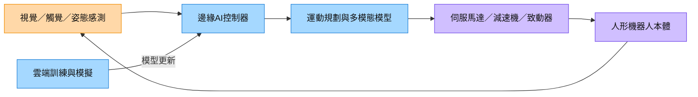

# 技術_人形機器人

## 2026-08-18 研究補充

[[20260821_1041_全球機器人產業前景_具身智能與台灣供應鏈研究]] 將人形機器人定位為「商業驗證與特定場域導入加速期」，不把 2026 年全面商用視為既定事實；觀察順序為客戶驗證、量產、單機成本與營收認列。報告並以 [[2308_台達電（市）]]、[[2395_研華（市）]]、[[2049_上銀（市）]] 作為具既有獲利底座的控制／電源／傳動觀察標的。

![[20260821_1041_全球機器人產業前景_具身智能與台灣供應鏈研究_001.png]]
圖說：研究報告將台達電列為控制／電源與自動化平台觀察標的；此圖為來源報告的台股標的整理頁，非公司訂單或營收證明。

## 定義

人形機器人是以接近人類身體結構與工作環境為目標的機器人平台，通常包含視覺／觸覺感測、即時控制、運動規劃、馬達驅動與電池系統。它與傳統固定式工業機器人的差異，在於需要在非結構化環境中感知、決策與移動。

AI 浪潮使人形機器人從單純自動化設備轉向 Physical AI：模型在雲端訓練，機器人在邊緣執行低延遲推論與控制。這會同時拉動運算晶片、記憶體、感測器、伺服馬達、減速機與電源管理需求，但商業化仍受可靠度、成本與安全認證限制。

### 2026-10 和椿科技《2026 機器人產業白皮書》

- 市場：2024 年全球新安裝工業機器人連續 4 年逾 50 萬台，電子業首度超越汽車業成最大應用；中國占安裝量 54%，本土品牌市占首次達 57%；日本機器人密度每萬名員工 399 台。智慧倉儲 2026 年約 US$34bn → 2035 年 US$115bn（CAGR 14.4%），服務機器人 2026 年 US$86bn → 2031 年 US$209.7bn（CAGR 19.51%）；2030 年 CAGR：工業 14%、協作 35%、AMR 14%、服務 17%、人形 40%。
- 人形機器人：2026 上半年全球出貨約 1.91 萬台，但真正投入生產環境比例低，多為科研教育、數據採集與展示；VLA 模型數據缺口高達 99.9%。2026 年預測分歧：SAG 約 6 萬台、蓋世汽車研究院上看 10 萬台、中國工信部目標整機產量破 10 萬台、Morgan Stanley 上調至 5 萬台、2030 年 44.6 萬台（CAGR 106%）。部分廠商轉向輪式／雙足人形用於倉庫取箱與廠內物流。
- 通用型機器人：協作手臂與 AMR 在台灣已成熟放量；AMR 全球 US$3.4bn → US$17bn（2026–2035，CAGR 19.5%），2024 年安裝 64,542 台（年增 12%、占工業機器人 11.9%），受惠 NVIDIA Jetson 等邊緣運算成本下降。
- 導入瓶頸：70% 以上面臨數位孤島、60% 以上陷入驗證陷阱、60% 以上存在整合隱形成本；成熟度分級為工業手臂（成熟）、協作手臂／AMR（條件式成熟）、人形（早期驗證）。AI 機器人市場 2023 年 US$12.3bn → 2033 年 US$146.8bn（CAGR 28.12%），中小企業偏好 RaaS。
- 來源：[[報告_和椿_2026機器人產業白皮書_20261027]]（和椿科技白皮書，原文未標確切日期，以收檔日 2026-10-27 記錄；廠商行銷性質，信心中）。

## 圖解

圖說：人形機器人以感測器形成閉迴路，邊緣控制器在本地完成即時推論，雲端則負責模型訓練與更新。

## 技術原理

| 模組 | 功能 | 觀察重點 |
|---|---|---|
| 感測器 | 感知視覺、姿態、力與環境 | 感測融合、延遲、可靠度 |
| AI 控制器 | 執行視覺模型、策略與運動規劃 | NPU／GPU 算力、記憶體頻寬、功耗 |
| 致動器 | 將決策轉換為關節運動 | 扭矩密度、效率、壽命與噪音 |
| 電源系統 | 支援移動與峰值負載 | 電池能量密度、熱管理、安全 |

相較固定式工業機器人，人形平台需要在感測不完整、地面與障礙物變動的環境中維持穩定控制，因此對邊緣推論、感測融合與故障安全的要求更高。

## 關鍵參數 / 判斷指標

### 出貨、任務成功與量產的分層驗證

[[報告_永豐_人形機器人產業_20260924]]（永豐投顧，2026-09-24）強調採購與穩定產線工作仍是不同階段。VLA 把視覺、語言指令與動作策略相連，真實資料品質及跨工件泛化決定可用性；這與僅展示運動能力或在單一流程重複作業的驗證層次不同。

| 指標 | 來源數字／說法 | 投資觀察與邊界 |
|---|---|---|
| 2026H1 出貨 | 永豐轉述 SAG：1.91 萬台、年增 272%、中國廠商占 97%；工業／商業用途占逾 70% | 第三方 estimate／中信心；出貨用途不能證明連續穩定生產，與 IFR 2025 年約 7,000 台的銷售口徑不可直接拼接 |
| 單一任務可靠度 | 智元 8 台、6 天、逾 6.4 萬次平板品質檢查，成功率 99.99% | 來源轉述／中低信心；特定任務與測試條件，不可外推通用能力 |
| 家庭泛化 | Figure 03 在 30 個未見家庭的 420 次任務中成功 235 次，約 56%；未用自家資料訓練模型約 9% | 來源轉述／中低信心；樣本、任務難度與人工介入須確認，不能和工廠 99.99% 橫比 |
| 整機價格與維護 | 報告把 US$20,000 以下列為普及觀察門檻 | thesis／中信心；還需計入維護、停機、訓練成本與有效工時 |
| 產能與對外交付 | Optimus 長期年產百萬台以上、售價 US$20,000–30,000；對外銷售最快 2027 年底 | 來源轉述的目標／estimate／低至中信心；產線布局不等於出貨與收入 |

> [!warning] 統計與政策邊界
> 永豐轉述的 IFR／SAG 統計、2026-07-29 FCC 管制範圍、豁免與美國營收曝險尚未逐項核對第一手公告；保留為來源說法，不據此確認政策適用範圍或將台灣供應商認定為美系已得標。結構化場景 2026–2028 試點、2030 前後大規模部署為產業情境。

| 指標 | 意義 | 投資觀察 |
|---|---|---|
| 每瓦算力 | 電池限制下的即時推論能力 | 有利邊緣 AI SoC、記憶體與電源管理供應商 |
| 扭矩密度 | 致動器在重量限制下的輸出 | 影響關節模組價值與整機效率 |
| 續航時間 | 單次充電可工作時間 | 決定商用部署與電池需求 |
| MTBF／安全認證 | 長時間運作與人機協作可靠度 | 認證與量產良率比單次 demo 更重要 |

## 產業動能

- **出貨放大後轉向可靠度與有效工時**：[[報告_永豐_人形機器人產業_20260924]] 將 2026H1 出貨增長與實際作業分開；[[688836.SH(unitree robotics)]] 的科研教育比重與扣非獲利，可檢驗「量增是否轉為商用獲利」。

- **Physical AI 成為半導體新需求**：[[人形機器人浪潮襲來，多元算立處理器發展方興未艾_DIGITIMES]]（DIGITIMES，2026-08-21）將人形機器人列為 2027 年半導體需求的潛在新動能。
- **雲端到邊緣的分工**：[[從雲端到邊緣AI_台系晶片設計產業動態解析_DIGITIMES]]（DIGITIMES，2026-08-21）指出邊緣推論與台系 IC 設計業者的營收成長仍需觀察量產落地。
- **Optimus 工程化驗證**：[[國金證券20260823-電腦產業研究：Optimus可望迎量產加速時刻]]（國金證券，2026-08-23）整理，Fremont 首代 Optimus 產線仍在安裝，初期產品將優先用於 Academy 的資料採集與功能開發；這是產線／訓練同步推進的訊號，不等於已對外大規模交付。
- **商業化由展示轉向量產指標**：同份報告認為後續應追蹤量產良率、產品均價、毛利率、客戶結構、復購率與場景複製能力，而非只以 demo 或出貨量判斷。

## 2026-11 Apptronik：整機口徑與有效作業

[[memo_Notion_AceCamp_Apptronik人形機器人商業化_70568717_20261102]]（2026-11-02）轉述Apollo迭代、約4小時續航與熱換電，屬文章描述／低信心，測試條件與版本待核。其32自由度與所列頭3＋雙臂14＋腰2＋腿6＝25不一致；日產2,500套→2026-12 4,000套亦未說明為零件、模組或完整整機，不納入全球整機出貨模型。

商業驗證應以客戶驗收台數、每班自主完成任務、人工介入、停機及維修成本評估；合作名單或產品展示不能證明安全認證與台灣零件商訂單。此框架與既有出貨／用途分層一致，完整待核項目見[[分析_Apptronik商業化與產能口徑核對_20261102]]。

## 2026-11 物理 AI：數據規模化與模型路線（東吳證券／群益上海）

- 定位：物理 AI 為生成式 AI、Agent 之後的第三階段，輸出由資訊、數位指令升級為實體動作，核心是掌握物理因果規律，面臨 Sim2Real 虛實遷移挑戰。成熟度分層（東吳）：AMR、工業巡檢已量產複製；四足巡檢單場景量產；人形機器人仍在探索、尚未規模化部署。智慧駕駛為最成熟場景：中國 1–9M26 L2 以上車型銷量 954.51 萬輛、3Q26 滲透率 73%，L2++ 以上 514.68 萬輛、3Q26 滲透率 44%（群益上海）。
- 模型三類分工（群益上海）：多模態基座模型偏理解與規劃（約 1,000ms／次）、世界模型偏模擬與預測、VLA 偏控制與執行（約 30–150ms／次）。東吳另列 WAM（世界動作模型，聯合預測動作與未來世界狀態，分聯合式與級聯式）。部署以分層架構為潛在主流：Figure Helix 以 System 2（VLM，7–9Hz）＋System 1（200Hz）＋System 0（1kHz）解決速度不匹配。
- 通用大模型控制機器人：Artificial Analysis 10 月 AA-Robotics 測試 GPT-6 Astra 69.4 分居首（群益上海）；英偉達測得 GPT-6 Astra 直接生成動作模式單次推理平均 18.56 秒，遠低於機器人伺服閉環所需 200Hz 以上，且難以穩定校驗動作的實際物理效果（東吳）。東吳引 Anthropic 資料：Claude Fable 5.2 Max 在 RoboDojo Sim 平均成功率 64.9%，為 GPT-6 Astra（29.8%）兩倍以上。宇樹王興興 10-22 世界物理 AI 大會認為具身智能「ChatGPT 時刻」最快 2027 年到來（群益上海）。
- 數據瓶頸（estimate）：2026 年初高品質人形機器人數據約 50 萬小時，通用具身模型需逾 1,000 萬小時、ChatGPT 級需數億小時；群益上海估全行業有效數據已超過 500 萬小時量級。數據來源成本：真機遙操作 500–1,000 元／小時、UMI 200–600 元、第一人稱人類行為約 100 元（有效比例 ≤4.2%）、模擬合成 20–50 元。東吳估 2026 年具身模型訓練數據以 Ego 為主（約 70%，仿真約 20%、遙操約 10%）；NVIDIA EgoScale 驗證第一人稱數據遵循 Scaling Law；頭部 Ego 供應商 Maxinsights 累計逾 200 萬小時、採集容量 45 萬小時／月；企業規劃達百萬至千萬小時，但實際存量多在十萬小時以內。
- 數採中心與市場：中國 106 個數採中心樣本中 84 個已營運（截至 2026-08）；沙利文估中國物理 AI 與世界模型數據服務市場 2025 年 82.8 億元，2030E 650 億元（CAGR 約 51%）。MIR 數據 1H26 中國人形機器人產量 2.5 萬台（為 1H25 的 4 倍以上）；高盛上修 2030／2035 年全球出貨至約 89 萬／650 萬台（原 25.6 萬／140 萬台）。靈巧手 2026 年出貨估突破 3 萬台，2025 年科研教育與數據採集合計占 74%，主流傳動組合為「腱繩＋直驅」（東吳）。
- 受惠環節（陸股為主，報告列名）：數採設備（奧比中光、利亞德、凌雲光、龍旗科技等）、數據服務（海天瑞聲、軟通動力、風語築、索辰科技、五一視界、寶通科技）、靈巧手與感測器（柯力傳感、兆威機電、禾賽、速騰聚創）、本體（[[688836.SH(unitree robotics)]]、優必選、上緯新材／智元）。
- 來源：[[報告_東吳證券_物理AI資料規模化與模型突破_20261114]]（東吳證券，2026-11-14）、[[報告_群益上海_物理AI與具身智能ChatGPT時刻_20261112]]（群益金鼎證券上海，2026-11-12）。

## 概念股 / 族群

| 類型 | 廠商 | 角色 | 觀察點 |
|---|---|---|---|
| 光學 | [[3019_亞光（市）]] | 機器人鏡頭 | 送樣轉量產與毛利率 |
| 邊緣運算 | [[技術_邊緣AI]] | 本地推論平台 | 算力、功耗與軟體整合 |
| 精密齒輪／減速器 | [[4571_鈞興-KY（市）]] | 諧波減速器、少齒差減速器、微型齒輪 | 2026 已向中國、台灣、美國客戶送樣；公司稱 2027 年部分客戶小量量產、2028 年後放量（[[活動_鈞興-KY4571_國泰CallMemo_20261117]]） |

> [!note] 信心水準
> 產業方向與技術需求有 DIGITIMES 研究支撐；個別公司進入特定人形機器人平台、訂單與量產時程仍待公告或客戶驗證。

## 技術瓶頸 / 風險

- **可靠度與安全**：人機協作需要可驗證的故障安全與長時間穩定運作。
- **成本與量產**：致動器、減速機、電池與高階運算模組的成本仍高。
- **資料與模型泛化**：真實場景資料不足可能造成模型在非預期環境失效。
- **量產節奏與供應鏈重置**：Optimus 涉及大量新零件與測試流程；產線爬坡、認證或設計更動均可能使零組件份額與放量時點延後。

## 相關技術

- [[技術_邊緣AI]]
- [[技術_GPU_Backstop]]

## 2026-11-19 中信：自動化與人形機器人零組件

- **市場**：Omdia 估全球人形機器人出貨 2025 年 1.33 萬台→2035 年 260 萬台（CAGR 69.5%）；2025–2027 年進入商業驗證與初期量產，2028 年後隨零組件標準化與成本下降加速規模量產。2025 年出貨前六大皆為中國廠、合計市占近 9 成，宇樹、智元各逾 5 千台，Tesla、Figure 各約 150 台；2027 年供應鏈由送樣驗證轉向量產採購（estimate／中）。
- **量產進度（原文表列）**：Tesla Optimus 3Q26 加州費利蒙開始生產，截至 10 月初 Gen3 累計 1,000–1,200 台供內部用，產線設計年產能 100 萬台；Figure 03 2026-04 累計交付逾 350 台，首條產線年產能 1.2 萬台、目標 2029 年底前累計 10 萬台；智元 1H26 出貨 9,700 台、截至 2026-09 累計 2 萬台（含輪式），年產能 10 萬台；宇樹 2025 年人形出貨逾 5,500 台、截至 2026-08 累計 1.8 萬台，規劃人形年產能 7.5 萬台。
- **用量**：六軸工業機器人約 6 顆減速機、6 顆伺服馬達；Optimus 身體 28 個致動器（14 旋轉、14 線性），整機馬達約 40 顆（無框 28＋空心杯 12），諧波減速機 14 顆＋手部行星 12 顆，線性致動器用行星滾柱螺桿 14 個，靈巧手 11→22 自由度。
- **行星滾柱螺桿**：線接觸，同體積承載約 3 倍、壽命可達 10 倍以上，適合上臂、大腿、小腿；滾珠螺桿傳動效率約 92–98%，適合手部、下臂。行星滾柱螺桿由歐洲廠主導，Rollvis、GSA、Ewellix、Rexroth 前四大合計 84%，[[2049_上銀（市）]]、[[4540_全球傳動（市）]] 積極布局。
- **台廠對應**：關節模組上銀、[[2464_盟立（市）]]、台達、東元；諧波減速機上銀、盟英、[[4571_鈞興-KY（市）]]、宇隆；無框力矩馬達 [[4576_大銀微系統（市）]]、東元；微型螺桿／滑軌上銀、[[1597_直得（櫃）]]；運動控制「小腦」[[7750_新代（市）]]。2030 年市場試算以出貨 80 萬台、零組件成本下降 5 成為假設（estimate／低–中）。
- **中國政策**：十五五規劃把基礎零部件、工業母機、人工智能＋、具身智能列為重點；2026 年 2,000 億元人民幣超長期特別國債支持設備更新已全數撥付，帶動數控系統、線性滑軌、氣動元件需求（[[1590_亞德客-KY（市）]]）。
- **工具機**：JMTBA 2026 年 9 月日本工具機訂單 2,232 億日圓（年增 60.4%，單月新高），10 月年增 42.5%、連續 16 個月成長，1–10 月累計年增 43.2%；1H26 外需年增 40.9%，台灣年增 96.3%；中信預期上行延續至 2027–2028 年。
- **CPO 對位**：CPO 晶圓級測試、光耦合組裝、光引擎測試與系統級測試均需精密平台、線性馬達、DD 馬達；六軸平台（3 平移＋3 旋轉）支援多通道一次對位，相關個股 [[4573_高明鐵（櫃）]]、大銀微、東佑達、直得、上銀。
- 來源：[[報告_中信_自動化產業景氣與成長展望_20261119]]。

## 2026-11-21 國金證券機器人週報：GPT-6.2 Astra 控制成功率翻倍、Optimus 量產爬坡

- 標準與需求：工信部批准《人工智能 關鍵基礎技術 具身智能數據生成系統技術要求》等 274 項行業標準，具身智能數據生成首次納入標準序列；商務部數據 2026 年 1–10 月重點平台具身智能機器人銷售額年增 25.2%。來源 [[報告_國金證券_機器人週報GPT6.2Astra與Optimus量產_20261121]]。
- 本體：現代汽車集團完成波士頓動力 100% 控股，規劃 2028 年 Atlas 年產 3 萬台，Atlas 2027 年初進入 GlobalFoundries 半導體廠測試；它石智航分批導入數百台工業具身機器人至線束產線；華碩 Gallop 進駐自有 EMS 工廠（Jetson Thor 平台，單塊主板配件打包目標 20 秒內、成功率 99.5%）；Genesis AI 完成 US$500mn A 輪。
- Tesla Optimus：V3 於 Fremont 投產，設計年產能 100 萬台；德州第二代產線長期設計年產能 1,000 萬台；早期 1–2 萬台內部使用與採集數據，目標 2027 年底前每週 2 萬台並啟動對外交付；優先重工業（採礦、冶煉），手部精細操作、耐久性與泛化能力仍待優化（公司說法）。
- 模型：XDOF Ember-0 實測 GPT-6.2 Astra 控制雙臂機器人 16 項任務成功率 41.2%（GPT-6 Astra 19.6%）；華為雲開源昇腾原生具身世界模型 CloudRobo-WM1.2；Gemini 4 Neon 成本較 Carbon 降約 40%。
- 零組件：格力開放伺服、減速器、驅動器對外配套；理想汽車外供 5nm 馬赫 M100（1,280 TOPS）；藍點觸控六維力傳感器市占 80%，交期壓縮至 2–3 週；黑芝麻智能於前海設具身智能總部。

## 來源

- [[報告_國金證券_機器人週報GPT6.2Astra與Optimus量產_20261121]]（國金證券，2026-11-21；機器人週報）
- [[報告_中信_自動化產業景氣與成長展望_20261119]] — 中信投顧，2026-11-19；人形機器人出貨與量產進度、Optimus 零組件用量、行星滾柱螺桿市占、日本工具機訂單。
- [[memo_Notion_AceCamp_Apptronik人形機器人商業化_70568717_20261102]] — 2026-11-02日期欄，產品規格與日產能口徑待核。

- [[報告_永豐_人形機器人產業_20260924]] — 永豐投顧，2026-09-24；產業數據、測試案例與商業化情境。

- [[人形機器人浪潮襲來，多元算立處理器發展方興未艾_DIGITIMES]] — DIGITIMES，2026-08-21
- [[從雲端到邊緣AI_台系晶片設計產業動態解析_DIGITIMES]] — DIGITIMES，2026-08-21
- [[國金證券20260823-電腦產業研究：Optimus可望迎量產加速時刻]] — 國金證券，2026-08-23
- [[國金證券20260823-機器人產業研究：特斯拉柏林工廠啟動機器人測試，世界機器人大會成功]] — 國金證券，2026-08-23
- [[報告_和椿_2026機器人產業白皮書_20261027]] — 和椿科技 2026 機器人產業白皮書（2026-10 收檔）

## 相關頁面

- [[4585_達明（市）]]
- [[時程_2026工業自動化與人形機器人]]

- [[6870_騰雲（櫃）]]
- [[分析_騰雲Tspace實體場域AI商業化_20260917]]
- [[3019_亞光（市）]]
- [[時程_2026記憶體與AI催化劑]]
- [[6907_雅特力-KY（櫃）]]（2026-10-27 批次新增引用）

