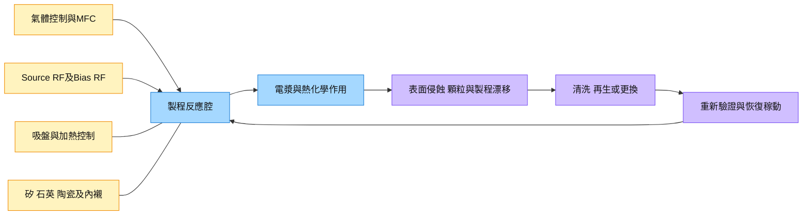

# 技術_半導體設備腔體耗材

## 定義

半導體製程腔體內部的矽、石英、陶瓷、SiC、金屬與密封零件，會因電漿、化學環境及熱循環而改變表面狀態，需要更換、清洗或再生。靜電吸盤／加熱器、RF／DC電源及氣體控制則是相鄰的功能零組件；其壽命與維護方式不同，不能全部按同一耗材更換頻率計算。

當設備稼動與製程複雜度改變，耗材需求取決於腔體運行時數、配方、零件位置及合格壽命。匿名紀要指出成熟件與高溫功能件供給分化，說明「能加工」與「長期合格運行」有差距。

本頁連接設備製程與[[技術_CMP]]等耗材研究；CMP耗材並非電漿蝕刻腔內零件，兩者僅共享按製程耗用及客戶資格評估的方法。原始依據為兩篇2026-07-18 Notion儲存本，尚未外部核對。

## 圖解

圖說：依兩份紀要整理的功能與維護鏈；實際設備不一定使用相同RF配置，各料號依腔體及配方驗證。

## 技術原理

| 模組／部件 | 功能 | 觀察重點 |
|---|---|---|
| 矽／石英件、環與內襯 | 配合腔體幾何、製程環境及電漿控制 | 表面侵蝕、顆粒、清洗後狀態與可用時數 |
| 陶瓷與SiC件 | 依用途提供絕緣、耐熱或耐製程環境能力 | 純度、孔隙、塗層、熱循環與污染；不可只按材料名稱替換 |
| 靜電吸盤／陶瓷加熱器 | 固持與溫度控制 | 吸附、溫度均勻性、漏電及多溫區控制 |
| RF源／偏壓及匹配器 | 依腔體架構提供電漿能量與偏壓控制 | 匹配穩定、重複性、失效與對製程的影響 |
| 氣體控制櫃／MFC | 管理製程氣體輸送與流量 | 流量精度、穩定、潔淨與料號資格 |

與一般精密加工零件相比，腔內零件還需控制污染、腐蝕、熱循環及製程重複性。替代料即使尺寸相同，仍可能改變顆粒或電性表現；客戶資格與長時間運行資料決定可替換性。

## 關鍵參數 / 判斷指標

| 指標 | 意義 | 投資觀察 |
|---|---|---|
| 合格運行時數 | 零件在指定配方下達到維護界限前的有效時數 | 比日曆壽命更接近實際耗用，需明確合格判據 |
| 清洗／再生迴圈 | 零件可重複使用次數與每次壽命 | 可減少新件採購，但帶動再生服務；不能把清洗等同新品更換 |
| 每腔每小時部件成本 | 各件價格除以可用時數後加總 | 需加上維護、停機與備品成本，才能比較替代品經濟性 |
| 腔體稼動與配方組合 | 決定電漿及熱化學暴露強度 | 同樣晶圓月產能不代表相同耗材需求 |
| 客戶驗證範圍 | 指定型號、節點、配方及產線的供貨資格 | 單一客戶某材料50%份額不能當整腔價值份額 |
| 庫存及重新採購 | 區分戰略備貨與實際消耗 | 高庫存可推遲短缺影響，也可能造成訂單波動 |

計算示例：[[memo_Notion_AceCamp_蝕刻耗材客戶與更換週期_70564211_20260718]]以20天×20小時＝400小時、原文4,000元零件得到10元／小時。這是方法示範，幣別、料號及壽命未核，不能當通用成本。更完整模型為各零件的「實現價格÷合格時數」加總，再加入維護與停機成本。

## 產業動能

- **供給按功能分化**：[[memo_Notion_AceCamp_半導體設備零件交期與替代_70563571_20260718]]（2026-07-18）稱一般成熟件供給較穩，高溫ESC、RF與部分高階閥件較難取得；單一匿名口徑，低至中低信心。
- **替代需客戶共同驗證**：同7-18紀要描述電源替代透過軟硬體修正、售後與備件維持uptime，不能由供貨成功推定性能完全一致。
- **耗材按實際用量認列**：[[memo_Notion_AceCamp_蝕刻耗材客戶與更換週期_70564211_20260718]]（2026-07-18）稱零件廠按客戶每月使用開票；新增廠房產能不直接等於收入。

## 概念股 / 族群

| 類型 | 廠商 | 角色 | 觀察點 |
|---|---|---|---|
| 設備平台 | [[AMAT.US(applied_materials)]] | 沉積等製程設備環節，本批用作供應鏈比較 | 原廠料號、客戶認證與服務；不採匿名來源的ESC份額為公司事實 |
| 設備平台 | [[LRCX.US(lam_research)]] | 蝕刻等製程設備環節，本批用作比較 | 腔型、配方、稼動與維護；不據此推新增訂單 |
| 矽／石英／陶瓷零件與再生 | 來源稱臻寶等，未建公司頁 | 匿名訪談描述的零件及再生服務 | 實體、客戶及分母需另核，不猜測客戶 |

> [!note] 信心水準
> 功能與評估框架可由兩份紀要支持；每類零件價目、RF約3,000小時、ESC三至四年、供應商份額與收購關係均為未核轉述，信心低，不作產品規格或已確認公司關係。

## 技術瓶頸 / 風險

- **資格不易移植**：不同腔型、配方及位置需要重新驗證，單一成功案例不能涵蓋全部製程。
- **替代成本被低估**：備件、現場服務、保固與停機可能抵銷低價；看uptime及總成本。
- **統計分母混用**：矽件份額、全部腔內件與設備總成本不同，不能互相反推。
- **需求不必然線性成長**：壽命延長、再生及低稼動可抵銷新增腔體；戰略備貨亦可放大短期採購。
- **來源數字存在疑義**：單腔每小時萬元與每日成本口徑不明，客戶地理名稱有混寫，不納入基礎模型。

## 相關技術

- [[技術_CMP]] — 其他半導體耗材的製程資格與耗用比較，產品及製程不同。
- [[技術_CoWoS與先進封裝]] — 下游封裝製程與設備投資，不能將前道腔體耗用直接套用。

## 來源

- [[memo_Notion_AceCamp_半導體設備零件交期與替代_70563571_20260718]] — AceCamp匿名專家，Notion日期2026-07-18。
- [[memo_Notion_AceCamp_蝕刻耗材客戶與更換週期_70564211_20260718]] — AceCamp零件廠專家轉述，Notion日期2026-07-18。

原訪談日未核；所有市場份額、合約及產品壽命仍須依具體料號與客戶資料核對。

## 相關頁面

- [[分析_EUV曝光產能與先進製程設備驗證_20260718]]
- [[分析_設備材料現貨與長約的供應驗證_20260705]]
- [[分析_設備訂單到合格交付的產能與收入邊界_20260718]]
- [[分析_半導體零件的腔體時數與合格供給_20260718]]
