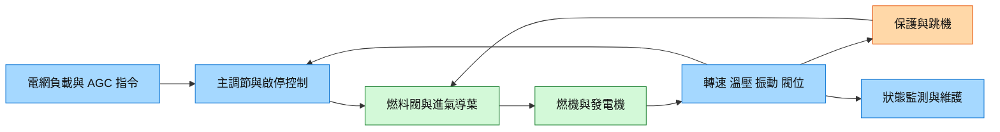

# 技術_燃氣輪機控制系統

## 定義

燃氣輪機控制系統協調燃料、進氣、啟動輔機與發電機，執行啟停順序、負載調節、燃燒穩定及保護。主調節迴路、獨立跳機保護與狀態監測目的不同，不能把一般廠區 DCS 或單顆 PLC 當成可直接替換的完整燃機控制。

AI 資料中心關注自備發電的可用率與快速負載變動，控制器是否適配特定機型、燃料組分與電網要求，比硬體單價更影響長期成本。控制層與 [[技術_800VDC供電架構]] 的電力轉換層不同：前者管發電機組，後者管機房至運算負載的配電。

本來源中的 AGC 指 Automatic Generation Control／自動發電控制，**不是玻璃公司 AGC**。別名使用全名，避免跨產業誤導。

## 圖解

圖說：主調節、保護與監測共享機組資料，但需以具體機型的安全架構分開驗證；此圖為概念整理。

## 技術原理

| 模組 | 功能 | 觀察重點 |
|---|---|---|
| 感測器與 I/O | 讀取轉速、溫壓、振動、閥位與火焰 | 校正、冗餘、故障診斷及取樣時序 |
| 主控制器 | 啟停順序、燃料空氣匹配、負載與溫度限制 | 機型模型、燃燒模式切換與動態穩定 |
| 執行器 | 燃料閥、IGV、防喘閥與輔機 | 動態響應、失效位置及備件相容 |
| 跳機保護 | 熄火、超速、振動與油壓異常時隔離 | 獨立性、誤跳與拒動風險、現場測試 |
| 監測與操作站 | 歷史趨勢、診斷、維護與人機介面 | 可維護性、資安、資料權利及停機窗口 |

與一般定速設備控制不同，燃機必須協調燃燒、壓氣機喘振邊界、溫度及併網狀態。同步機併網後的負載調節涉及燃料與輸出功率，不能僅理解為任意升降轉速。來源的點火轉速、3,000rpm 與聯合循環 1–3 小時啟動只屬特定機型／工況，不作統一操作指引。

## 關鍵參數 / 判斷指標

| 指標 | 意義 | 投資觀察 |
|---|---|---|
| 全工況控制與保護覆蓋 | 啟停、甩負荷、燃料波動的穩定性 | 現場長期運行資料比展示控制器更能形成壁壘 |
| 響應與可用率 | 指令、感測、執行器及機組的整體反應 | 單一毫秒延遲不等機組可用率 |
| 燃燒與排放 | 低氮模式、燃燒振盪與排氣溫度 | 改造可能影響效率、壽命與維護費 |
| 存量改造成本 | 停機、工程、備件、保固及培訓 | 訪談稱便宜至少 50% 未含完整 TCO，低信心 |

## 產業動能

- **存量改造：** [[memo_Notion_AceCamp_燃氣輪機控制與存量改造_70564109_日期待確認]]（原日期未標）稱華電 9E 與國電南瑞等參與改造；僅訪談轉述，未核專案原文件。
- **原廠服務與適配：** 同來源提及 GE、三菱等原廠的機型資料與長期服務協議；既有公司研究入口為 [[GEV.US(ge_vernova)]]、[[6503.JP(mitsubishi electric)]]，不據此建立本批具名新客戶訂單。
- **快速調頻：** 同來源將深度調峰、燃料自適應與預測維護列為升級方向；需求不等新控制系統已取得合約。

## 概念股 / 族群

| 類型 | 廠商 | 角色 | 觀察點 |
|---|---|---|---|
| 原廠生態 | [[GEV.US(ge_vernova)]] | 燃機與服務研究入口 | 具體機型控制及長協範圍 |
| 原廠生態 | [[6503.JP(mitsubishi electric)]] | 三菱集團相關研究入口 | 實際燃機合約法人須另確認 |
| 存量控制改造 | 國電南瑞／中控等（本庫未建公司頁） | 訪談所列候選參與者 | 以具名專案、驗收與連續運行核對 |

> [!note] 信心水準
> 原理為本來源的系統分工整理，中信心；國產替代成本、專案與認證說法低至中信心。未外部查證，未把受訪者的合約／市場准入主張當通用法規。

## 技術瓶頸 / 風險

- **機型資料與動態模型：** 原廠保護閾值、燃燒切換及全工況資料不易替換。
- **整合可靠性：** 感測、閥件、通訊與軟體移轉可能增加誤跳、停機及工程成本。
- **保固與權利：** 是否影響保固依實際合約，不能通稱更換必失保。
- **市場准入與資安：** 出口與電網要求按地區、系統與合約核對，不能概括全部需同一 UL 認證。

## 相關技術

- [[技術_800VDC供電架構]]
- [[技術_BBU與CBU機櫃儲能]]

## 來源

- [[memo_Notion_AceCamp_燃氣輪機控制與存量改造_70564109_日期待確認]] — AceCamp 匿名專家訪談；發布／訪談日期未標，2026-11-13 整理。
