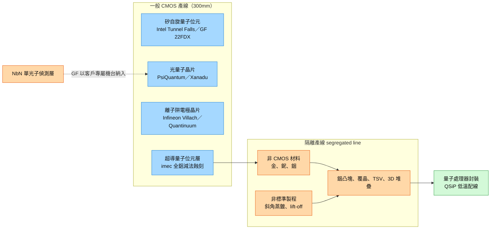

# 技術_量子晶圓代工

## 定義

量子晶圓代工（Quantum Foundry）指替他人代工量子晶片的晶圓廠，對象除了量子位元（qubit）晶片，還包含離子阱晶片、光量子晶片，以及在極低溫下控制與讀取量子位元的晶片。本頁採 [[memo_PhotonCap_量子晶圓代工與隔離產線_20261024]] 的定義，只把「收錢替他人代工的商用產線」（merchant line）視為量子代工，與國家實驗室共享服務（MIT Lincoln Lab SQUILL 的 MPW）、開放式研究 fab（KAIST 國家量子 fab）、名為 foundry 的研究中心（UCSB NSF Quantum Foundry）、自用 fab（Google、Rigetti、IQM）區分。

為什麼現在重要：量子晶片年晶圓量只有數十到數百片（QCR 估算），相較 GlobalFoundries 2025 年出貨超過 234 萬片 300mm 約當晶圓，營收規模極小；但美國商務部 2026-05-21 與 9 家量子公司簽署 US$2.013bn 意向書，其中 68% 給了 IBM（US$1bn）與 GlobalFoundries（US$375mn）兩家代工的製造技術開發，並同時取得股權。PhotonCap 的判讀是：量子代工賣的不是晶圓量，而是一條與一般 CMOS 產線隔離的「隔離產線」（segregated line），價值由誰握有這條產線決定。

主線連結：光量子與矽自旋路線建立在 300mm 矽光子與先進 CMOS 平台上，與 [[技術_矽光子（SiPh）]]、[[供應鏈_AI光互聯]] 共用代工產能；超導路線的覆晶、TSV 與 3D 堆疊與 [[技術_混合鍵合]] 的後段整合問題相近。

## 圖解

圖說：矽自旋、光量子、離子阱已走「在商用 300mm 產線加模組」的路；超導路線的量子位元層可留在 CMOS 線（Fraunhofer EMFT 在銦製程步驟才讓晶圓離開 CMOS 線），銦凸塊、堆疊與封裝則留在隔離產線。

## 技術原理

| 模組 | 功能 | 觀察重點 |
|------|------|----------|
| 非 CMOS 材料 | 超導量子位元用鋁、鈮、銦；金會在矽能隙中段形成缺陷能階 | 各廠標準不同：GF 300mm 量產線已接受 PsiQuantum 的 NbN 偵測層；Fraunhofer EMFT 把 200mm 試產線分成 CMOS 區與鈮／銦專區 |
| 非標準製程 | 實驗室常用斜角蒸鍍與 lift-off | imec：會留光阻殘渣、在大尺寸晶圓失去再現性，與量產大致不相容；imec 改全鋁＋減法蝕刻，300mm 線上 400 顆 qubit 有 393 顆可運作 |
| 約瑟夫森接面（JJ） | 兩層超導金屬夾數個原子層厚的絕緣膜，決定超導 qubit 頻率 | imec 數據：單晶片內電阻離散約 4%、頻率離散約一半，5GHz qubit 約 100MHz；IBM 以雷射加熱調校、Rigetti 以電脈衝把電阻離散壓到約 0.5% |
| 凸塊與堆疊 | qubit 晶片與配線晶片覆晶，以銦凸塊接合；TSV 與 3D 堆疊 | Google Sycamore 用銦凸塊；Anderon 製程選單並列超導配線、TSV 與凸塊；qubit 數增加後堆疊不可避免，這段會持續變大 |
| 量子 PDK | 代工廠提供的設計套件 | Anderon 2026-10 推出第一版超導量子 PDK（qubit、I/O、放大器、濾波器），公開版未揭露設計規則與材料 |
| MPW | 一片晶圓集合多個使用者設計 | MIT Lincoln Lab SQUILL 每片晶圓集合略多於 100 個使用者設計 |

與一般晶圓代工的差異：一般代工以晶圓量與稼動率計價，量子代工的門檻在「超精密加工」——JJ 數個原子層的阻障與介面、凸塊的污染、對位與接觸均勻度；光量子與半導體自旋晶片同樣需要微影準確定義圖形，才能達到所需損耗與均勻度。是否需要隔離產線因路線而異，但這種精密度是各路線共同的底層。

## 關鍵參數 / 判斷指標

| 指標 | 意義 | 投資觀察 |
|------|------|----------|
| 年晶圓量 | 量子晶片年需求數十到數百片（QCR） | 晶圓營收撐不起估值，量子對 GF 股價影響仍幾乎看不出來 |
| 政府資金與入股 | 商務部 68% 意向書資金給兩家代工；GF 以每股 US$37.85 發行 990 萬股新股，約 1.8% | 政府先買下「任何路線都能接」的美國本土產線，而不是押注單一 qubit 路線 |
| 外部客戶 | Anderon 尚無具名外部客戶；SkyWater SC250 有 Qolab 多年期首發客戶 | 首張外部合約是 merchant line 是否成立的驗證點 |
| 設計週期與 lot 數 | IonQ 稱與 SkyWater 共同開發後設計週期由 9 個月降到 2 個月、6 個月內 wafer lot 為前代工廠 12 倍 | 公司自述，前代工廠未具名；但說明握有產線等於買到時間 |
| JJ 均勻度 | 頻率離散直接決定超導 qubit 良率 | 製程後調校（雷射、電脈衝）能力是超導代工的差異化 |
| 超導 merchant line 持有者 | IBM（Anderon）、IonQ（SkyWater）、QuantWare 都同時賣自家 qubit／處理器 | 競爭者握有產線，客戶有轉單與資訊風險；FTC 也假設緊急換廠會延誤數個月 |

## 產業動能

- **商務部意向書與股權**：2026-05-21 商務部與 9 家量子公司簽 US$2.013bn 意向書；9 月 [[GFS.US(globalfoundries)]] CHIPS 獎助最高 US$375mn 定案（2026-09-08），GF 同意以每股 US$37.85 對商務部發行 990 萬股；D-Wave 最終協議附少數、非控制性持股；IBM 10-Q 揭露 Anderon 對商務部發行少數股權，比例未揭露，IBM 保有控制權。來源 [[memo_PhotonCap_量子晶圓代工與隔離產線_20261024]]。
- **Anderon（IBM）**：2026-05 宣布成立；9 月商務部最終研發獎助最高 US$1bn，約三分之二簽約即可動用、其餘依里程碑撥付，附便利終止權與部分追回條款；IBM 另投入 US$1bn 現金與 IP、資產、人員（現金已到位）。以 NY CREATES 經營的 Albany NanoTech 300mm 線為基地，全天候運轉；9 月首批量子晶圓投片，10 月第一版 PDK。CEO Mukesh Khare 稱年底前可交付外部客戶，IEEE Spectrum 報導 Rigetti 正洽談，尚未宣布合約。產業傳聞人數不到 100 人（未見官方資料）。
- **IonQ 併購 SkyWater**：2026-01 宣布、7 月底完成，宣布時股權價值約 US$1.8bn；SkyWater 有明尼蘇達 200mm fab 與 DMEA Trusted Foundry 認證，2025 年營收約 US$440mn 級，與量子公司有 8 個開發專案。9 月推出 SkyWater Quantum Solutions，SC250（多層鈮配線上加 JJ 層）與 SP90（氮化矽光子平台，首批晶圓已出貨、完整平台 2027 年），Qolab（CTO John Martinis）簽為 SC250 首發客戶，產品為 QSiP 低溫配線封裝。
- **D-Wave 協議寫入 SkyWater fab**：D-Wave 2026-09-04 與商務部簽的 CHIPS 協議，專案地點列入 SkyWater 明尼蘇達 Bloomington 廠，距 IonQ 完成併購約一個多月；PhotonCap 付費段落以此展開價值歸屬討論（未收錄）。
- **GF 與 Tower**：GF 自 2019 年與 PsiQuantum 開發光量子晶片，自旋路線有 Quantum Motion（22FDX 上逾 1,000 個量子點）、Equal1、Diraq；2026-05 成立 Quantum Technology Solutions；2026-09-08 Quantinuum 列 GF 為下一代 300mm 離子阱製造廠之一；2026-10-06 Xanadu 宣布偵測器與氮化矽上 GF Malta 300mm 線。GF 超導目前只揭露低溫讀取／控制晶片與超導互連，無外部超導 qubit 代工實績。[[TSEM.US(tower semiconductor)]] 自 2021 年起揭露中唯一量子夥伴為 Xanadu（2026-02 擴大合作），2025 年報正文未出現 quantum。
- **其他產線**：[[INTC.US(intel)]] 在 300mm D1 線以近似標準 CMOS 邏輯流程做 Tunnel Falls，晶圓良率 95%；[[IFX.DE(infineon)]] Villach 廠一片 200mm 熔融石英晶圓約可容納 500 顆離子阱晶片；Rigetti 在 Fremont Fab-1 以 150mm 自製並預期未來至少 3 年可滿足自用；IQM 擴建芬蘭產線；OQC 以 Fraunhofer EMFT 試產線為標準製造據點；QuantWare 擴建新 fab，Quantum Foundry Copenhagen 興建中。
- **韓國**：KAIST 國家量子 fab 至 2031 年投入逾 KRW45bn，2027 年完工、2028 年全面運轉，完全開放、支援光子／點缺陷／中性原子；超導由成均館大學 QFab（水原，3–6 吋晶圓每季投片）負責，KRISS 2024 年 20 qubit 系統由成均館與 UNIST 設計製造；KOSDAQ 上市 Sawnics 參與 KAIST 主導 KRW10bn 量子光子積體電路代工計畫；UNIST 今年春天啟用 KRW30bn 量子奈米 fab。韓國尚無類似 Anderon、GF 的 merchant line。

## 概念股 / 族群

| 類型 | 廠商 | 角色 | 觀察點 |
|------|------|------|--------|
| 商用代工（多路線） | [[GFS.US(globalfoundries)]] | 光量子（PsiQuantum、Xanadu）、矽自旋（22FDX）、離子阱（Quantinuum）；商務部入股約 1.8% | 是否取得外部超導 qubit 代工案；量子對營收貢獻仍極小 |
| 矽光子代工 | [[TSEM.US(tower semiconductor)]] | Xanadu 合作 | PhotonCap 定位為「附帶量子選項的 AI 矽光子代工」 |
| 自有產線 | [[INTC.US(intel)]] | 300mm D1 線 Tunnel Falls 矽自旋晶片 | 自用研發，未見對外量子代工 |
| 離子阱製造 | [[IFX.DE(infineon)]] | Villach 200mm 熔融石英離子阱晶片 | 與 Innsbruck 研究合作，未見商業代工合約 |
| 超導 merchant line | IBM（Anderon）、IonQ（SkyWater）、QuantWare | 超導量子位元代工 | 首張外部合約；競爭者持有產線的客戶顧慮 |
| 自用超導產線 | Google、Rigetti、IQM | 自家 qubit 製造 | Rigetti 是否轉向 Anderon |

> [!note] 信心水準
> 政府資金、入股與併購數字來自 NIST／SEC／FTC 等一次文件，經 PhotonCap 整理，信心高；IonQ 設計週期與 lot 數為公司自述；Anderon 人數不到 100 人為產業傳聞，信心低。IBM、IonQ、D-Wave、Rigetti、SkyWater 在本庫尚無公司頁，僅以純文字記錄。

## 技術瓶頸 / 風險

- **晶圓量與營收不對稱**：年需求數十到數百片晶圓，代工經濟性依賴政府資金與股權，不是晶圓營收。
- **超精密加工**：JJ 均勻度直接決定超導 qubit 良率，目前需靠製程後雷射／電脈衝調校。
- **材料與製程相容性**：金、鈮、銦、lift-off 與 CMOS 線不相容，各廠標準不同；鉭與藍寶石基板目前無一次來源說明哪些廠允許。
- **競爭者持有產線**：超導 merchant line 多由同時賣 qubit 的公司持有；FTC 主席聲明假設緊急換廠會延誤數個月。
- **離子阱 PDK 缺口**：耐數百伏 RF 電壓的電極與紫外到可見光波導仍不在標準 PDK 內。
- **政府合約條款**：Anderon 獎助附便利終止權與追回條款，約三分之一依里程碑撥付。

## 相關技術

- [[技術_矽光子（SiPh）]]
- [[技術_混合鍵合]]
- [[供應鏈_AI光互聯]]

## 來源

- [[memo_PhotonCap_量子晶圓代工與隔離產線_20261024]] — PhotonCap（Substack），2026-10-24；免費段落完整，第 8 節起付費段落未收錄

## 相關頁面

- [[GFS.US(globalfoundries)]]
- [[TSEM.US(tower semiconductor)]]
- [[INTC.US(intel)]]
- [[IFX.DE(infineon)]]
- [[時程_2026-2028十月券商催化劑]]
