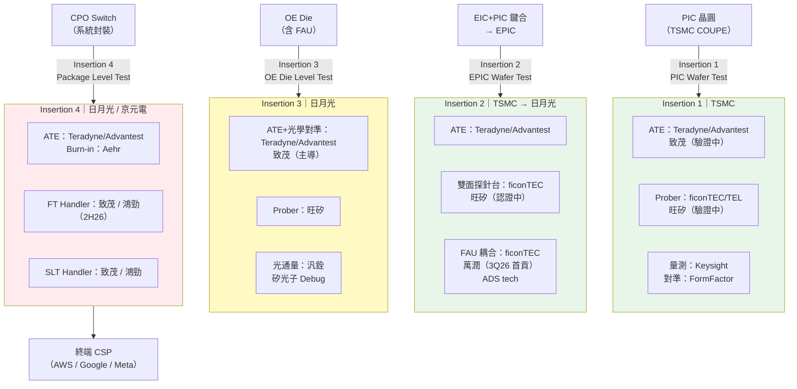
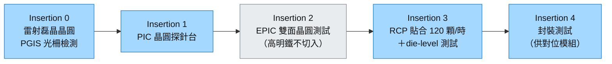

# 供應鏈_光測試設備

## 主軸

CPO（Co-Packaged Optics）及矽光子元件從晶圓到系統封裝需經過 **4 個測試節點（Insertion 1-4）**，每個節點有完全不同的測試設備組合。本頁記錄各 Insertion 的測試設備玩家、測試地點，以及台廠的切入位置。

> 與 [[供應鏈_CPO]] 的分工：供應鏈_CPO 記錄「光引擎零組件」的製造供應鏈；本頁記錄「光引擎如何測試」的測試設備供應鏈。

---

## 全覽：4 Insertion 設備地圖

![[光測試期中產業報告_009.png]]

> Insertion 1-2 測試地點在台積電（晶圓廠）；Insertion 3 移至 OSAT（日月光）；Insertion 4（CPO Switch 系統封裝後）在日月光/京元電，需 ATE + FT Handler + SLT Handler。台廠可切入的主要角色標示為橘色。（來源：SRS 光測試期中產業報告，2026-07）

---

## 各 Insertion 詳細拆解

### Insertion 1｜PIC Wafer Level Test（測試地點：台積電）

光子 IC（PIC）在晶圓廠完成後的第一道測試。測試 PIC 上的環形共振器（Ring Resonator）、光調變器（Modulator）、光電二極管（PD）、耦合器（Coupler）等元件的 DC 電性與光學特性。

![[光測試期中產業報告_010.png]]

> PIC 晶圓包含多種光學元件，每種元件測試項目不同：Ring Resonator 測頻寬/波長/偏壓；PD 測 Dark Current/Responsivity；Coupler 測 Insertion Loss/Optical Return Loss。（來源：SRS，2026）

| 角色 | 玩家 | 台廠 | 狀態 |
|------|------|------|------|
| ATE / Tester | Teradyne、Advantest | [[2360_致茂（市）]]（驗證中） | 外資主導，致茂搶入 |
| Prober（光路探針台） | ficonTEC、TEL | [[6223_旺矽（櫃）]]（光電探針台，驗證中） | 旺矽切入驗證 |
| 光學對準（FAU/光柵） | FormFactor | — | 仍外資壟斷 |
| 量測儀器 | Keysight、Advantest | — | 外資主導 |

**測試重點**：光柵耦合（Grating Coupler）將光路引出晶圓面，偏差 0.5µm → 50% 光功率流失；測試精度要求 < 0.3µm。

---

### Insertion 2｜EPIC Wafer Level Test（測試地點：台積電 → 耦合製程移至日月光）

> [!warning] 2026-11-06 SWTest負面訪查（未確認量產結果）
> [[活動_SWTest_Day2光電測試與cHBM_20261106]] 指晶圓翹曲使電接觸與下方光學校準互相牽制：移動載台需重校光路，壓平則有內裂風險；估2027機台量可能不多。筆記對 [[6223_旺矽（櫃）]] 中性、對 [[7856_漢測（櫃）]] 與ficonTEC負面，屬estimate／低；「ficonTEC刺破晶圓出局」是rumor／低，不更新下方供應商地位為確定失單。既有工程服務、INS1／3／4與FAU貼合需求亦不能一併推論取消。分析見 [[分析_SWTest_INS2翹曲與cHBM探針門檻_20261106]]。

EIC（Electrical IC）與 PIC 混合鍵合為 EPIC 後的晶圓級測試。需**雙面同測**：上方傳統探針卡接觸 EIC 電性接點，下方光纖光學探針耦合 PIC 光學面（需開槽晶圓卡盤）。

測試後進入 **FAU 貼合耦合製程**（Insertion 2 後製程，在 OSAT 日月光進行）：將光纖陣列（FAU）精密對準並 UV 固化貼合至 OE（光引擎）Die 上。

| 角色 | 玩家 | 台廠 | 狀態 |
|------|------|------|------|
| ATE / Tester | Teradyne、Advantest | — | 外資主導 |
| 雙面光電探針台 | ficonTEC、旺矽 | [[6223_旺矽（櫃）]]（開槽卡盤雙面台，認證中） | 旺矽核心機會 |
| 光學對準 | ficonTEC | — | 外資壟斷（交期 9-12 個月） |
| FAU 貼合耦合設備 | ficonTEC、萬潤、ADS tech | [[6187_萬潤（市）]]（UPH 優於 ficonTEC，3Q26 首貢獻） | 關鍵瓶頸 |
| 耦合地點（OSAT） | [[3711_日月光投控（市）]] | — | ASE/SPIL 為主要耦合廠 |

**瓶頸**：FAU 耦合對位精度 < 0.3µm，是整條 CPO 產線最難良率管控點。萬潤以更短交期挑戰 ficonTEC 壟斷。

---

### Insertion 3｜OE Die Level Test（測試地點：日月光）

光引擎（OE = OE Die，含 FAU 的組件）在系統封裝前的 Die 級測試。同時驗證光性（插入損耗、波長、光功率）與電性（SerDes 訊號完整性、224G PAM4 高速訊號）。

| 角色 | 玩家 | 台廠 | 狀態 |
|------|------|------|------|
| ATE / Tester + 光學對準 | Teradyne、Advantest、ficonTEC | [[2360_致茂（市）]]（ATE + 奈米對準，主導 Insertion 3） | 致茂核心強項 |
| Prober | 旺矽 | [[6223_旺矽（櫃）]]（Die Level 探針台） | 確認切入 |
| 光通量檢測儀器 | 汎銓、光焱 | [[6710_汎銓（市）]]（矽光子 Debug 設備；IR-OM 光損偵測） | 小眾但高利潤 |
| 測試地點 | [[3711_日月光投控（市）]] | ASE/SPIL | OSAT 主測試地 |

**台廠優勢**：Insertion 3 是致茂最明確的切入點（整合式 ATE + 光學對準 + 量測三合一平台）；旺矽探針台與致茂 ATE 協作；汎銓 IR-OM 設備做光路 Debug。

---

### Insertion 4｜CPO Switch Package Level Test（測試地點：日月光 / 京元電）

最終封裝後的系統級測試——ASIC（CPO Switch）與光引擎整合成完整 CPO 模組後，進行光電同測（外部雷射注入 + 電性測試 + SLT 系統驗證）。

| 角色 | 玩家 | 台廠 | 狀態 |
|------|------|------|------|
| ATE / Tester | Teradyne、Advantest | — | 外資主導 |
| Burn-in | Aehr、Advantest | — | 外資主導 |
| 量測儀器 | Keysight、Anritsu、ficonTEC | — | 外資主導 |
| **FT Handler**（光電同測，主力） | **[[2360_致茂（市）]]**（ATE 主導）、**[[7769_鴻勁精密（市）]]**（3kW ATC，開發中 2H26 量產目標） | 兩家台廠 | 最高價值環節 |
| **SLT Handler**（純光測試） | **[[2360_致茂（市）]]**、**[[7769_鴻勁精密（市）]]** | 兩家台廠 | 致茂 SLT 可省 ATE 直接測 |
| 測試地點 OSAT | [[3711_日月光投控（市）]]、[[2449_京元電子（市）]] | — | 日月光/京元電 為主 |

**台廠集中度高**：Insertion 4 是 CPO 測試設備 ASP 最高、台廠參與最深的環節。致茂主 ATE/SLT，鴻勁主 FT ATC Handler（已有數百台 CPO 電性測試 ATC Handler 出貨，Insertion 4 光電同測 2H26 目標量產）。

---

## 供應鏈結構圖

---

## 台廠對照表

| 公司 | 切入 Insertion | 核心產品 | 狀態 | 時機 |
|------|--------------|---------|------|------|
| [[2360_致茂（市）]] | 1（驗證）/ 3（主導）/ 4（主導） | ATE + 光學對準；FT/SLT Handler | 3/4 已確認，1 驗證中 | 已有明確訂單 |
| [[6223_旺矽（櫃）]] | 1（驗證）/ 2（認證）/ 3（確認） | 光電探針台、雙面探針台 | 各階段認證進行中 | 認證 → 量產 |
| [[6187_萬潤（市）]] | 2 後製程（FAU 耦合） | 光耦合設備（UPH > ficonTEC） | 3Q26 首次貢獻 | 搶 ficonTEC 份額 |
| [[7769_鴻勁精密（市）]] | 4（FT + SLT Handler） | CPO ATC FT Handler（光電同測） | 2H26 量產目標 | 高 ASP，已有 Insertion 3 電性 Handler 基礎 |
| [[6710_汎銓（市）]] | 3（光通量量測） | 矽光子 Debug 設備（IR-OM 光損偵測） | 年底首台設備出貨 | 小眾高利潤 |
| [[3711_日月光投控（市）]] | 2 後（FAU 耦合地點）/ 3 / 4 | OSAT 測試地點 | 現有 CPO OSAT 基礎 | 作為場地持有者受益 |
| [[2449_京元電子（市）]] | 4 | OSAT 測試地點 | — | 測試外包需求 |
| [[6706_惠特（市）]] | 雷射晶片 bar test／分 bin 代工；2 後製程（FAU 耦光） | InP 雷射／PD bar test、劈裂、分 bin 代工；上詮 CPO 耦光對位設備、MPO 設備 | 代工 2026 年底月產能 11–12KK；耦光設備試產前段 | 代工 3Q26 放量；CPO 設備 2027 較大量（[[活動_惠特私訪_20260422]]、[[活動_惠特私訪_20260701]]，公司方說法） |
| [[4573_高明鐵（櫃）]] | 1（晶圓探針台／耦光量測）／3（RCP 貼片＋die-level，FAU 耦合＋單顆雙面 CPO 測試） | 6 款主動對位耦合整機、次系統模組與晶圓級耦光量測；detachable RCP 設備 2026-12 出成品 | 2026 年 7 月營收年增 298.5%、由虧轉盈；毛利率 50% 出頭、目標 55–58%（[[活動_高明鐵4573_技術論壇Memo_20261021]]） | 光模組廠 800G／1.6T 放量；點膠固化採標準件（[[報告_CPO耦光對位設備三強比較_萬潤高明鐵惠特_20260902]]、[[報告_永豐_智璞專家分享會_矽光子與CPO趨勢_20260921]]） |

---

## 外資競爭者

| 公司 | 角色 | 競爭地位 |
|------|------|---------|
| ficonTEC（德） | 光學對準 + CPO 耦合設備（Insertion 1-3）| 實質壟斷，交期 9-12 個月；萬潤/旺矽挑戰 |
| Teradyne（US） | ATE（Insertion 1-4 全程） | 與 Advantest 雙寡頭 |
| Advantest（JP，6857.JP） | ATE + Burn-in | 同上 |
| FormFactor（US） | 光學對準探針台（Insertion 1） | 工程驗證階段主力 |
| Keysight（US） | 量測儀器（Insertion 1/4） | 廣泛使用 |
| Aehr（US） | Burn-in 系統（Insertion 4） | IC Burn-in 專家 |

---

## 投資觀察

### 2026-05-21 Aletheia 更新

[[260521_2360致茂_aletheia_ATE]] 估計致茂在 NVIDIA 32x OE switch IC 流程中，可能是 Insertion 3 OE die tester 與 Insertion 4 light-in/light-out tester 的主要甚至獨家供應商；報告估計 2026–2028 年兩段 TAM 約 NT$100 億與 NT$300 億以上，市占與營收金額屬券商 estimate，仍需以 POR、客戶驗證與出貨確認。

1. **CPO 測試是「picks-and-shovels」環節**：即使 CPO 量產時程下修，測試設備仍比組件廠商更早採購，且每顆 OE Die 必測，不受架構路線影響（任何 CPO 設計都需走 4 個 Insertion）。

2. **台廠集中在 Insertion 3/4**：附加值最高的兩個節點，致茂與鴻勁在 Insertion 4 的 FT/SLT Handler 互補而非純競爭（致茂偏 ATE 主機整合，鴻勁偏 Handler 熱控）。

3. **旺矽受益於「無論哪種 CPO 架構都需要探針台」**：PIC 架構（TFLN / SiPh / InP）無論哪條路線勝出，測試端的探針台需求都成立。

4. **ficonTEC 替代為中期風險**：萬潤、旺矽均在挑戰 ficonTEC 壟斷；若台廠切入成功，整體光耦合設備供應鏈本土化比例將大幅提升（設備交期縮短，有利 CPO 量產加速）。

---

## 相關頁面

- [[7856_漢測（櫃）]]（SWTest筆記討論INS2機台與工程服務風險）
- [[活動_SWTest_Day2光電測試與cHBM_20261106]] — 2026-11-06來源筆記。
- [[分析_SWTest_INS2翹曲與cHBM探針門檻_20261106]]

- [[3587_閎康（櫃）]]
- [[4573_高明鐵（櫃）]]
- [[AEHR.US(aehr)]]
- [[供應鏈_AI光互聯]]
- [[供應鏈_CPO]]（CPO 光引擎零組件製造供應鏈）
- [[供應鏈_半導體測試設備]]（AI/HPC Final Test ATE Handler，與 Insertion 4 FT/SLT 有交集）
- [[技術_CPO]]（CPO 技術原理）
- [[7769_鴻勁精密（市）]]（FT ATC Handler）
- [[2360_致茂（市）]]（CPO ATE + Handler）
- [[6223_旺矽（櫃）]]（光電探針台）
- [[6187_萬潤（市）]]（FAU 耦合設備）
- [[6710_汎銓（市）]]（矽光子 Debug 設備）

## 2026-09-18 光焱測試設備更新

- [[7728_光焱（櫃）]]以 NightJar-H、FireFox、APD-QE 與 ProbeInsight 覆蓋 PIC／矽光子測試；1H26 營收 NT$2.08 億、毛利率 63.66%，AI 矽光子測試占 1–8 月營收 17.2%，均為公司／券商整理。
- NightJar-H HVM／客戶驗證預計 2026 年底前，對應 CPO 2027–2028 年商用化與 12 吋 PIC 轉換；新廠預計 1Q–2Q28 完工、2H28 量產。公司頁待使用者確認後再建立。

來源：[[報告_CTBC_光焱_20260918]]（中信投顧，2026-09-18）。

![[光焱(7728,Note)-CTBC260918_001.png]]

圖說：光焱產品線涵蓋光／電半導體測試設備；圖片取自本批中信投顧來源，產品分類與公司簡報口徑仍待正式揭露交叉驗證。

## 2026-09 耦光對位三強分工與 Insertion 2 測試產能瓶頸

- **避免分類誤判：測光 vs 對光 vs 黏光（2026-09-02）**：[[報告_CPO耦光對位設備三強比較_萬潤高明鐵惠特_20260902]] 拆解三家官網規格指出，只有 [[6706_惠特（市）]] 真正銷售元件級光電參數量測測試機（L-I-V、波長、光形）兼代工；[[4573_高明鐵（櫃）]]（光模組廠六軸對位工站）與 [[6187_萬潤（市）]]（封測廠先進封裝整線＋全自製點膠固化）機台內建的光功率計均屬「製程閉環放行驗證」，三家真正重疊的站點僅「FAU／光引擎耦合」一格。亦不可將高明鐵機構重複定位 ±50 nm 與萬潤端到端對位 ±2.5 µm 直接相除比較。
- **Insertion 2 卡的不是精度，是產能（2026-09-21 智璞，pp.48–49、53）**：[[報告_永豐_智璞專家分享會_矽光子與CPO趨勢_20260921]] 指出 Insertion 1 已達 <5 秒／die（成熟），但 Insertion 2 雙面探測（上電下光＋次微米對光）量產機台（Teradyne＋ficonTEC）2025-03 才出現，單片耗時約 20 小時（量產目標須壓至 6–8 小時），因此現行小量階段常「先跳過 Ins 2、直接切單裝 receptacle 到 Ins 3 一起測」，代價是壞 die 消耗 receptacle 與主動對位機台時間。量產解法包含：Jenoptik UFO 探針卡（批次對準一次、免逐顆主動對準）、ATE 多站並測，以及 PIC 內嵌微透鏡降軸（逐顆僅調 XYZ）。

![[報告_CPO耦光對位設備三強比較_萬潤高明鐵惠特_20260902_001.png]]
*圖（2026-09-02 三強比較報告，p4）：惠特、高明鐵與萬潤於矽光子與 CPO 產線之站點守備範圍對照，深色為主力機種、淺色為非主力，真正重疊僅 FAU／光引擎耦合。*

![[報告_永豐_智璞專家分享會_矽光子與CPO趨勢_20260921_p48.png]]
*圖（智璞 2026-09-21 整理 p48）：CPO 四道測試流程中 Insertion 2 現階段權宜跳過與量產必補的產能瓶頸及三類工程解法。*

![[報告_永豐_智璞專家分享會_矽光子與CPO趨勢_20260921_p49.png]]
*圖（智璞 2026-09-21 整理 p49）：CPO 四道測試工序設備版圖——前兩道以國際 ATE 廠為主，台廠集中於 Insertion 3–4（萬潤、高明鐵、致茂、鴻勁、穎崴）與 Insertion 2 雙面探針台（旺矽）。*

## 2026-10-21 高明鐵技術論壇：各 Insertion 供應商與 RCP 瓶頸

設備商 [[4573_高明鐵（櫃）]] 在技術論壇整理的各段供應商如下，屬單一設備商口述（thesis／中），與上方 SRS／智璞版圖可交叉比對，不代表客戶 POR（[[活動_高明鐵4573_技術論壇Memo_20261021]]）：

| Insertion | 地點（現況） | 站點 | 供應商（論壇口徑） |
|---|---|---|---|
| 1 | 晶圓廠 | Wafer prober | FormFactor、高明鐵（工研院計畫機台） |
| 1 | 晶圓廠 | EIC／PIC tester；PIC test | Teradyne、Advantest；TEL |
| 2 | 晶圓廠 | Tester | Keysight、Anritsu |
| 2 | 晶圓廠 | Double side wafer level | 布局「已定」：Advantest＋[[6223_旺矽（櫃）]]、ficonTEC＋Teradyne |
| 3 | OSAT | Coupling（RCP 貼片） | ADST、高明鐵、All Ring（[[6187_萬潤（市）]]） |
| 3 | OSAT | Die level | ficonTEC、Chroma（[[2360_致茂（市）]]）、高明鐵 |
| 4 | 台積電，之後應移往 OSAT | Handler；Socket | [[7769_鴻勁精密（市）]]、[[2360_致茂（市）]]、Teradyne；[[6515_穎崴（市）]] |

- **RCP 是 Insertion 3 前段的最大瓶頸**：凡用台積晶片且需插拔，就要先把 receptacle（RCP）主動對位貼到切割後的 OE 晶片，上方 FAU 才能拆換。RCP 沒貼準，光纖扣上後 IL 必然偏高、後段測試無意義。設備需求量大、OSAT 幾乎滿載、NVIDIA 把該段集中在一家 OSAT，客戶因此壓 UPH（RCP 與 dFAU 結構見 [[技術_FAU]]）：ADST 一代機 10 片／時、二代機 40 片／時，高明鐵被要求 120–130 顆／時（2026-12 出成品）。設備未標準化、幾乎都是客製機，格局約 2027 年底較明朗。
- **Insertion 2 仍在爭議**：布局雖定，但電測後再測光太慢、成本太高；有說法是 Insertion 2 不測、移到 Insertion 3，但切割後才發現問題更麻煩。MPI 端主要問題是切割後翹曲，與上方 SWTest 負面訪查的翹曲議題一致。
- **設備決策權**：各段設備多由 NVIDIA 指定，Broadcom、AMD 等客戶另有偏好的供應鏈。

> [!warning] 衝突：Insertion 4 測試地點
> - 本頁上方（SRS 光測試期中報告，2026-07）：Insertion 4 在日月光／京元電。
> - 高明鐵技術論壇（2026-10-21）：Insertion 4「現在還在台積電」，之後應移到 OSAT。
> - 兩者可能分別描述量產規劃與目前工程／試產階段，暫並列，待 OSAT 或台積電揭露確認。

> [!note] 分類差異：RCP 耦合屬 Insertion 2 後製程或 Insertion 3
> 上方 Insertion 2 表把 FAU 貼合耦合列為「Insertion 2 後製程（OSAT）」，論壇與智璞 p49 則歸入 Insertion 3 coupling。兩種說法指的都是切割後在 OSAT 的貼合站，只是命名不同。

## 2026-09 高明鐵閉門法說：Insertion 0 雷射晶圓檢測與 RCP 速度比較

[[活動_高明鐵4573_參訪電訪SEMICON閉門Memo_20260915]]（2026-08-26 參訪至 09-15 國票閉門法說彙整）比 10-21 論壇早一個月，多了以下設備面細節（公司說法／中）：

- **Insertion 0（雷射磊晶段）：** PGIS 非破壞式光柵檢測以繞射法整片 mapping 取代刮片抽檢，先用於 DFB 雷射、下一代做 panel-level；[[3105_穩懋（櫃）]]、[[3081_LandMark光電（市）]]、[[2455_全新（市）]] 已過認證、2026Q4 出貨，中國源杰科技（688498.SH，未建頁；與台灣 [[7907_源傑科技（興）]] 為不同實體）約 2028 年再推。單價 1,700–2,200 萬元，約一般機台 2 倍，公司稱尚無同類對手。這把光測試設備的範圍往前延伸到 Insertion 1 之前的雷射晶片段。
- **Insertion 1 晶圓探針台：** 2026-09 推出，RD 稱精度已與 FormFactor 相當。
- **Insertion 2 不切入：** 方案已固定（如 [[6187_萬潤（市）]] 搭 [[6857.JP(advantest)]]）。這與上方論壇「Advantest＋旺矽、ficonTEC＋Teradyne」的組合不同，兩份都是同一家設備商口述，暫並列。
- **Insertion 3 RCP 貼合速度：** 點膠＋固化 10 秒、測試 20 秒，合計 30 秒，即 120 顆／時；同業韓廠（ADST）一代機 10 顆／時、二代機 40 顆／時、其他台廠一代機 60 顆／時。RCP 貼合機 2026-12 進 [[2330_台積電（市）]] 量產線做機台計算與測試。
- **Insertion 4：** 只供對位模組給 [[7769_鴻勁精密（市）]]、[[2360_致茂（市）]]，不做整機。
- **耦光設備對手：** 公司認為用日商（神津、中央、駿河精機）的客戶不易換，主要對手是港建代理的韓商 ADST——攤位稱重複定位 0.3 µm、耦光 90–180 秒、單價 800 萬元以上；高明鐵稱自家 50–100 nm、8–9 秒、700 萬元起。這些是競爭者攤位口述與公司自述，未經第三方實測（信心中低）。

圖說：依 2026-09 閉門法說整理的高明鐵站點布局；藍色為公司有產品的站點，灰色為不切入的 Insertion 2。

## 來源

- [[活動_高明鐵4573_參訪電訪SEMICON閉門Memo_20260915]] — 高明鐵參訪／國票閉門法說 memo，2026-09-15（Insertion 0 PGIS、Insertion 1 探針台、RCP 120 顆／時與同業速度、ADST／日商比較）。
- [[活動_高明鐵4573_技術論壇Memo_20261021]] — 高明鐵技術論壇 memo，2026-10-21（各 Insertion 供應商、RCP 瓶頸與 UPH、Insertion 2／4 地點）。
- [[報告_CPO耦光對位設備三強比較_萬潤高明鐵惠特_20260902]] — 獨立設備供應鏈比較研究，2026-09-02（惠特／高明鐵／萬潤站點守備範圍、規格對照、專利與國際／台灣耦光陣營盤點）。
- [[報告_永豐_智璞專家分享會_矽光子與CPO趨勢_20260921]] — 永豐證券／智璞產業趨勢研究所，2026-09-21（SiPh 測試成本占比 ~75%、Insertion 1–4 瓶頸與設備版圖）。
- [[活動_SWTest_Day2光電測試與cHBM_20261106]] — SWTest 筆記，2026-11-06。
- [[報告_CTBC_光焱_20260918]] — 中信投顧，2026-09-18。
- [[光測試期中產業報告]] — Securities Research Society，2026-07-01。
