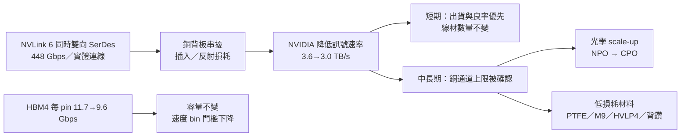

# 分析_VeraRubin規格下修_NVLink與HBM4頻寬的產業影響_20261031

## 問題背景

SemiAnalysis 於 2026-10-30 在 X 指出，NVIDIA 已把 Vera Rubin NVL72 的 NVLink 6 頻寬由每顆 GPU 3.6 TB/s 下修到 3.0 TB/s。原因是同時雙向 SerDes 在全速下，串擾與插入／反射損耗造成的訊號完整性問題。外部報導比對產品頁後發現，HBM4 頻寬也一起下修，修改時間約在 2026-09 上旬；NVIDIA 隨後回應，新數字是「量產可持續的規格」。本頁判斷這次下修代表什麼產業訊號，結論先講：**不代表 AI capex 轉弱，而是 rack 內銅互連與 HBM 介面已逼近物理極限。中長期價值會往光學 scale-up 與低損耗材料移動。**

## 關鍵發現

- SemiAnalysis X 貼文（2026-10-30，查詢日 2026-10-31）：NVLink 6 每 GPU 3.6→3.0 TB/s（約 −17%）。Vera Rubin 採雙向 SerDes，每條實體連線理論全速 448 Gbps，但串擾、插入損耗與反射損耗在此速度下難以克服，NVIDIA 因此降低訊號速率。SemiAnalysis 稱已在其 Accelerator Model 中揭露。（[原文](https://x.com/SemiAnalysis_/status/2116003079950602611)）
- SemiAnalysis 早先貼文說明：Vera Rubin 相對 GB300 每 GPU NVLink 頻寬翻倍，是在銅背板上改用同時雙向 SerDes 達成，沒有提高調變或 baud rate。（[原文](https://x.com/SemiAnalysis_/status/2037635994032230788)）
- Hardware Busters（2026-10-26）與 Wccftech（2026-10-29）比對產品頁，修改約在 2026-09-01～09-11：HBM4 每 GPU 22→19.2 TB/s，NVL72 機櫃 HBM4 1,580→1,400 TB/s、NVLink 260→216 TB/s，HGX NVL8 HBM4 176→130 TB/s。HBM4 容量 288GB 與每 GPU NVFP4 50 PF 不變；scale-out 網路頻寬每 Superchip 0.8→0.9 TB/s。（[Hardware Busters](https://hwbusters.com/news/nvidia-quietly-lowers-vera-rubin-hbm4-bandwidth-and-the-hgx-nvl8-loses-a-quarter-of-it/)、[Wccftech](https://wccftech.com/nvidia-official-statement-on-vera-rubin-spec-change/)）
- NVIDIA 官方聲明（Wccftech 轉述，2026-10-29）：開發期公布的是初步架構目標，新規格反映「品質合格、量產時系統可持續的表現」；已發表的第三方 benchmark 均以量產規格量測；NVL72 已全面量產出貨。
- TechPowerUp 歸因（經 Hardware Busters 轉述）：HBM4 每 pin 由 11.7 降到 9.6 Gbps，問題在 NVIDIA 端介面而非記憶體廠；NVLink Nyquist 頻率由 56 降到 47 GHz，可放寬 SerDes、線材與板材要求並改善良率。Wccftech 另轉述是 HBM4 供應商難以達到原速度 bin。兩種歸因並存，NVIDIA 未說明。
- [[報告_SemiAnalysis_RubinUltraNVL576_20260810]]（2026-08-10）：Rubin Ultra NVL576 的 Oberon 把 NVLink Switch tray 數量加倍，用意是控制最遠的銅背板通道距離；rack 之間走 NPO／CPO。這與本次銅通道訊號完整性的瓶頸方向一致。
- [[261019_ms_OCP-MGX]]（Morgan Stanley，2026-10-19）：Kyber 延後後焦點回到 Oberon，NVIDIA 改評估 Rubin Ultra 採 NVLink PTFE PCB，導入時程未定（見 [[技術_正交背板]]、[[NVDA.US(nvidia)]]）。
- [[memo_AceCamp_高速銅纜與AEC供應鏈_20260918]]（2026-09-18，匿名訪談、低信心）：DAC 有效距離約 1–1.5 m，AEC 可達 3.5–4 m，但速率提升後 2–5 m 段會被光纖取代；Amphenol、Molex、TE 合計約 75–80% 市占。
- [[memo_國泰_美股開盤AI基建記憶體光通訊_20261029]]（2026-10-29）把「22→19.2 TB/s」寫成 Rubin Ultra 改採 8 層 HBM4／HBM4E 的結果。依 NVIDIA 產品頁與官方聲明，19.2 TB/s 是**現行 Vera Rubin** 的修正規格，國泰 memo 混入了 Rubin Ultra 的 HBM 分級傳聞（見 [[分析_MS_AI供應鏈_HBM降規與Kyber延遲_20260810]]）。

## 投資重點 memo

| 重點 | 投資含義 | 相關標的 | 信心 |
|------|----------|----------|------|
| rack 內銅 scale-up 的物理牆在量產上被驗證 | Rubin Ultra／Feynman 世代光學 scale-up（NPO 先、CPO 後）的必要性提高；時程未必提前，但方向更確定 | [[3363_上詮（櫃）]]、[[6442_光聖（市）]]、[[NVDA.US(nvidia)]] | 中 |
| 降速不減少線材與連接器數量 | 銅纜、連接器短期出貨不受影響，訊號完整性要求放寬，良率與交期可能改善 | [[APH.US(amphenol)]]、[[3665_貿聯-KY（市）]]、[[CRDO.US(credo)]]、[[3533_嘉澤（市）]] | 中 |
| 下一代要把速度拉回，只能靠更低損耗的通道 | PTFE／M9 CCL、HVLP4 銅箔、背鑽、高密度 socket 的升級邏輯被強化 | [[2383_台光電（市）]]、[[1303_南亞（市）]]、[[2368_金像電（市）]]、[[3037_欣興（市）]]、[[3167_大量科技（市）]] | 中 |
| HBM 每 GPU 容量不變、pin 速度下修 | 位元需求不下修；速度 bin 門檻降低，供給與良率改善，高速 bin 的差異化溢價被稀釋 | [[000660.KR(sk_hynix)]]、[[005930.KR(samsung)]]、[[MU.US(micron)]] | 中低 |
| AMD 帳面記憶體頻寬與容量追平或超越 | Helios 多了行銷素材；decode 受記憶體頻寬限制，13% 差距可能反映在 tokens/s 上，但 AMD 量產規格也未驗證 | [[AMD.US(amd)]]、[[NVDA.US(nvidia)]] | 中低 |
| 保住時程、讓出規格 | 出貨量型供應鏈（ODM、電源、散熱、PCB 數量）中性偏正面；規格升級型環節要預期下一代仍有規格折讓 | [[NVDA.US(nvidia)]] | 中 |

## 受惠鏈（影響方向）

| 環節 | 短期（Vera Rubin NVL72） | 中長期（Rubin Ultra／Feynman） | 代表標的 | 信心 |
|------|--------------------------|-------------------------------|----------|------|
| 光學 scale-up（NPO／CPO、FAU、MPO、光纖） | 無直接變化 | 正面：銅已到極限，跨 rack 甚至 rack 內改走光的理由增加 | [[3363_上詮（櫃）]]、[[6442_光聖（市）]] | 中 |
| 銅纜／背板連接器／AEC | 中性偏正面：數量不變、良率改善 | 中性偏負面：448G 銅距離更短，2–5 m 段被光替代 | [[APH.US(amphenol)]]、[[3665_貿聯-KY（市）]]、[[CRDO.US(credo)]] | 中 |
| 低損耗 PCB／CCL／銅箔／背鑽 | 中性 | 正面：要恢復速度必須升級材料（PTFE、M9／M10、HVLP4） | [[2383_台光電（市）]]、[[1303_南亞（市）]]、[[2368_金像電（市）]]、[[3037_欣興（市）]]、[[3167_大量科技（市）]] | 中 |
| HBM | 中性：容量與位元不變 | 中性：速度溢價被稀釋，但供給吃緊不變 | [[000660.KR(sk_hynix)]]、[[005930.KR(samsung)]]、[[MU.US(micron)]] | 中低 |
| 高速 SerDes IP／socket | 中性 | 正面：224G→448G 世代訊號完整性設計價值提高 | [[3533_嘉澤（市）]]、[[CRDO.US(credo)]] | 中低 |

圖說：Vera Rubin 規格下修的傳導路徑。NVLink 與 HBM 兩條下修分別指向「互連介質升級」與「記憶體速度溢價稀釋」；本頁推論，非 NVIDIA 官方說法。

## Insight 結論

| 結論 | 投資含義 | 信心 |
|------|----------|------|
| NVLink 降速是銅通道訊號完整性的量產極限，不是需求問題 | 不應解讀為 AI 硬體需求轉弱；NVL72 仍量產出貨 | 中高 |
| 同一年內出現 Rubin Ultra HBM 分級、Kyber 延後、Spectrum 6 CPO 延期與本次降規 | NVIDIA 一年一代的節奏以規格折讓換取時程；未來規格預期應打折看待 | 中 |
| 頻寬上限從「SerDes 速度」轉成「通道介質」問題 | 價值往光學與低損耗材料移動，純靠更快 SerDes 撐銅互連的路線要打折 | 中 |
| HBM 降速但不降容量 | HBM 位元需求與供給吃緊的 thesis 不受影響，只是速度 bin 溢價縮小 | 中 |

> [!tip] 結論／投資觀點
> Vera Rubin 規格下修是「物理極限訊號」，不是「需求訊號」。短期出貨與供應鏈營收大致不受影響；中長期價值往光學 scale-up 與低損耗材料移動，高速銅互連與 HBM 速度溢價的天花板變低。
> 信心水準：中

## 數據彙整

| 項目 | 原規格 | 修正後 | 來源 | 日期 |
|------|--------|--------|------|------|
| NVLink 6／GPU | 3.6 TB/s | 3.0 TB/s | SemiAnalysis X、NVIDIA 產品頁（Wccftech 比對） | 2026-10-30 |
| NVLink 6／Superchip | 7.2 TB/s | 6.0 TB/s | Wccftech | 2026-10-29 |
| NVL72 NVLink 合計 | 260 TB/s | 216 TB/s | Wccftech | 2026-10-29 |
| HBM4 頻寬／GPU | 22 TB/s | 19.2 TB/s | Wccftech、Hardware Busters | 2026-10-29 |
| HBM4 每 pin 速率 | 11.7 Gbps | 9.6 Gbps | TechPowerUp（經 Hardware Busters 轉述） | 2026-10 |
| NVLink Nyquist 頻率 | 56 GHz | 47 GHz | TechPowerUp（經 Hardware Busters 轉述） | 2026-10 |
| NVL72 HBM4 合計 | 1,580 TB/s | 1,400 TB/s | Wccftech | 2026-10-29 |
| HGX NVL8 HBM4 合計 | 176 TB/s | 130 TB/s | Wccftech | 2026-10-29 |
| HGX NVL8 HBM4 容量 | 2.3 TB | 2.0 TB | Wccftech | 2026-10-29 |
| Scale-out 網路／Superchip | 0.8 TB/s | 0.9 TB/s | Wccftech | 2026-10-29 |
| HBM4 容量／GPU | 288 GB | 288 GB | Wccftech | 2026-10-29 |
| AMD MI455X HBM4 | 432 GB；約 19.6 TB/s（另有 23.3 TB/s 口徑） | — | Futurum、Tom's Hardware 等 | 2026 |

## 關鍵 Claim

| Claim | 類型 | 來源 | 日期 | 信心 |
|-------|------|------|------|------|
| Vera Rubin NVLink 6 由 3.6 下修至 3.0 TB/s／GPU | fact（官方產品頁） | SemiAnalysis X；Wccftech 比對 NVIDIA 產品頁 | 2026-10-30 | 高 |
| HBM4 由 22 下修至 19.2 TB/s／GPU，容量 288GB 不變 | fact（官方產品頁） | Wccftech、Hardware Busters | 2026-10-29 | 高 |
| 下修原因是 448G 雙向 SerDes 的訊號完整性限制 | estimate／研究機構解讀 | SemiAnalysis X | 2026-10-30 | 中 |
| HBM4 降速原因在 NVIDIA 介面端，而非記憶體廠 | estimate | TechPowerUp（轉述） | 2026-10 | 低 |
| HBM4 供應商難以達到原速度 bin | estimate | Wccftech 轉述 SemiAnalysis 相關報導 | 2026-10 | 低 |
| NVL72 已全面量產出貨，benchmark 以量產規格量測 | company_comment | NVIDIA 聲明（Wccftech） | 2026-10-29 | 高 |
| 22→19.2 TB/s 屬 Rubin Ultra 8 層 HBM 方案 | 已更正：與官方產品頁不符 | [[memo_國泰_美股開盤AI基建記憶體光通訊_20261029]] | 2026-10-29 | 低 |
| 光學 scale-up 必要性提高、低損耗材料升級邏輯強化 | inference | 本頁 | 2026-10-31 | 中 |
| HBM 速度 bin 溢價被稀釋，位元需求不變 | inference | 本頁 | 2026-10-31 | 中低 |

> [!warning] 資訊衝突
> - [[memo_國泰_美股開盤AI基建記憶體光通訊_20261029]]（2026-10-29）：稱 Rubin Ultra 改採 8 層 HBM4／HBM4E，Rubin GPU 頻寬 22→19.2 TB/s。
> - NVIDIA 產品頁與官方聲明（Wccftech，2026-10-29）：19.2 TB/s 是現行 Vera Rubin（NVL72／NVL8）的修正規格，適用所有 Vera Rubin 組態。
> - 狀態：採官方口徑。Rubin Ultra 的 HBM 分級另見 [[分析_MS_AI供應鏈_HBM降規與Kyber延遲_20260810]]，兩者不是同一事件。
> - AMD MI455X 頻寬口徑：19.6 TB/s 與 23.3 TB/s 並存，未查證，僅作比較參考。

> [!todo] 反證條件 / 待確認
> - [ ] 若 Rubin Ultra 的 NVLink 恢復或超越 3.6 TB/s 且仍用 rack 內銅，「銅已到極限」的推論需下修。
> - [ ] 若 NVIDIA 在 Rubin Ultra 以 retimer／AEC 方式補足銅通道，而不是改走光，銅纜環節的中長期負面判斷失效。
> - [ ] 追蹤 HBM4 速度 bin 的價格差是否縮小；若高速 bin 仍有溢價，「溢價稀釋」推論不成立。
> - [ ] 驗證 scale-out 網路 +12.5% 是否為計算口徑改變（例如納入 BlueField-4），還是實際 NIC／光模組頻寬增加。
> - [ ] AMD Helios 量產規格是否同樣下修；若 AMD 也降規，競爭面影響抵銷。
> - [ ] 取得 SemiAnalysis 推文第 2/2 則原文與 Accelerator Model 細節。

## 來源引用

- SemiAnalysis X 貼文（1/2）— 2026-10-30，查詢日 2026-10-31：[原文](https://x.com/SemiAnalysis_/status/2116003079950602611)
- SemiAnalysis X 貼文（NVLink 6 同時雙向 SerDes）— 查詢日 2026-10-31：[原文](https://x.com/SemiAnalysis_/status/2037635994032230788)
- Hardware Busters — 2026-10-26：[原文](https://hwbusters.com/news/nvidia-quietly-lowers-vera-rubin-hbm4-bandwidth-and-the-hgx-nvl8-loses-a-quarter-of-it/)
- Wccftech（NVIDIA 官方聲明）— 2026-10-29：[原文](https://wccftech.com/nvidia-official-statement-on-vera-rubin-spec-change/)
- TechPowerUp — 2026-10（網站拒絕擷取，內容經 Hardware Busters 轉述）：[原文](https://www.techpowerup.com/354133/nvidia-cuts-hbm4-speed-and-nvlink-bandwidth-targets-for-vera-rubin)
- Futurum（Helios vs Rubin）：[原文](https://futurumgroup.com/insights/amd-helios-reaches-parity-with-vera-rubin-nvl72-can-open-standards-outflank-nvidia/)
- [[分析_MS_AI供應鏈_HBM降規與Kyber延遲_20260810]] — 2026-08-16 建立
- [[報告_SemiAnalysis_RubinUltraNVL576_20260810]] — SemiAnalysis，2026-08-10
- [[261019_ms_OCP-MGX]] — Morgan Stanley，2026-10-19
- [[memo_AceCamp_高速銅纜與AEC供應鏈_20260918]] — AceCamp 匿名訪談，2026-09-18
- [[memo_國泰_美股開盤AI基建記憶體光通訊_20261029]] — 國泰，2026-10-29（Rubin Ultra 歸屬已更正）

## 相關頁面

- [[NVDA.US(nvidia)]]
- [[技術_HBM高頻寬記憶體]]
- [[技術_CPO]]
- [[技術_光互連]]
- [[技術_正交背板]]
- [[分析_MS_AI供應鏈_HBM降規與Kyber延遲_20260810]]
