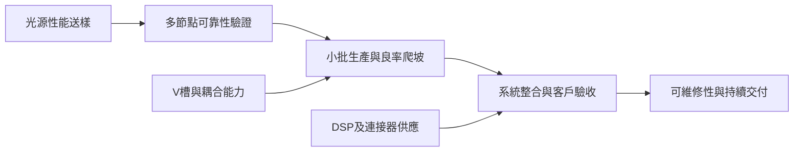

# 分析_光互連架構選擇與驗證良率瓶頸_20261030

## 問題背景

四份十月紀要指出，高速光互連的限制不只在雷射晶粒，還有微槽、耦合、可靠性與現場維修。需要區分特定系統選擇與通用技術定義。研究主張：以整個可維修鏈路的良品交付能力衡量瓶頸，並保留不同客戶架構的差異。

## 關鍵發現

- [[memo_Notion_AceCamp_CPO_DFAU產能與耦合瓶頸_70568130_20261030]]（2026-10-30）匿名廠商稱傳統FAU月交付20萬只、目標2027Q1–Q2達40萬；CPO保偏FAU月供1萬–2萬只、接近人民幣200元，完整FAU＋MUX／DEMUX＋跳線方案約US$400。三者不是同一產品單位。
- 同來源稱36通道DFAU的V-groove加工良率60%–70%，2027-03預計取得高精度切割機；人工組裝與耦合制約月產3萬→10萬的擴張。所稱光斑「0.16以下」未附單位，不轉作加工規格。
- [[memo_Notion_AceCamp_Rubin_NPO可維修性與MMC供應_70567848_20261029]]（2026-10-29）將NPO定位為Scale-up可維修方案：局部模組可更換，CPO則可能需整板維修；文內3.2T NPO的DFAU36為4根保偏＋32根單模光纖。不能把此特定方案外推全部NPO。
- [[memo_Notion_AceCamp_光晶片功率驗證與DFAU量產_70568558_20261028]]（2026-10-28）匿名廠商稱70→100mW光源驗證約6–8個月；2000小時可靠性測試含168／500／1000小時多節點，總流程約4個月，小批2–3個月與良率爬坡3–4個月可能部分重疊。
- [[memo_Notion_AceCamp_北美DCI直採與相干光供給_70568395_20261023]]（2026-10-23）稱CSP將系統與相干模組拆開直採，訂單分批下達；Coherent在Google相干模組約40%口徑不能與Nokia系統約50%相加。Coherent-lite對應園區1–10km，與傳統長距DCI不同。

## 延伸來源交叉檢查（2026-11-13）

| 來源與日期 | 新增資料點及衝突 | 類型／信心 |
|---|---|---|
| [[memo_Notion_AceCamp_NPO封裝送樣與EIC_PIC架構_70563180_20260610]]；原日期見 Raw，未明者待確認 | 2026-06-10 匿名封裝廠稱 4 月送中際樣、5 月滿意；新易盛僅高層接觸，未證明訂單。CPO＝3D、NPO＝2.5D 是概括混層，不採定義。 | 訪談／作者 estimate，低至中；算術核對高 |
| [[memo_Notion_AceCamp_CPO與NPO交付及價值分工_70562118_日期待確認]]；原日期見 Raw，未明者待確認 | CPO 2026Q4 數千／1 萬、2027 20 萬是訪談展望；OCS 為光路交換，CPO／NPO 為封裝位置，可以同時存在，不能按地區互斥分類。 | 訪談／作者 estimate，低至中；算術核對高 |
| [[memo_Notion_AceCamp_CPO電光測試與耗材壽命_70560925_20260416]]；原日期見 Raw，未明者待確認 | 2026-04-16 測試訪談稱 2028 後 CPO 量產，與另一篇 2026Q4 工程交付須分階段；25 萬次 touchdown 乘 site 數不是良品數，詳見電光測試分析。 | 訪談／作者 estimate，低至中；算術核對高 |

這些補充不改寫較晚來源或原有結論。數字須先對齊產品、階段與分母，再用正式文件及實際交付驗證；不把重複轉述當獨立確認。

## 投資重點 memo

| 重點 | 投資含義 | 相關標的 | 信心 |
|---|---|---|---|
| 微槽與耦合放大可能比普通FAU擴產困難 | 追蹤每站良率、產線節拍及返工，不只追設備台數 | [[技術_FAU]] | 中低 |
| 系統維修成本會改變NPO／CPO採用順序 | 用客戶可接受的停機時間及交換機形態判斷滲透率 | [[NVDA.US(nvidia)]] | thesis／中低 |
| 雷射可靠性有多階段驗證 | 送樣、性能通過、可靠性通過與量產分開追蹤 | [[LITE.US(lumentum)]]、[[COHR.US(coherent)]] | 中低 |
| DCI拆分採購增加直接供貨機會 | 觀察模組與系統份額及代工範圍，不能重複計入同一需求 | [[GOOGL.US(alphabet)]]、[[COHR.US(coherent)]] | 中低 |

## 比較表

| 架構 | 該份來源的選擇 | 驗證／經濟限制 | 解讀邊界 |
|---|---|---|---|
| 10-29特定NPO | 內置光源、約2cm保偏纖、LGA介面、冷板 | 現場模組更換與交換機SLA | 不是所有NPO規格 |
| 10-29特定CPO | 外置光源、光纖可到約35cm | 整板維修、供光功率及熱環境 | 不是通用保偏纖長度 |
| 10-30匿名DFAU | V槽、Lens Array、兩定位銷、半自動反射法耦合 | 精度、人工操作、V槽良率 | 廠商未辨認，不附會公司份額 |
| 相干／Coherent-lite | 長距DCI／園區中距分開 | DSP、光源、功耗、直採資格 | EML及DSP規格需產品文件再核 |

*圖：依四份紀要整理的驗證流程；各產品所需時間不同，步驟可部分重疊。*

## Insight 結論

| 結論 | 投資含義 | 信心 |
|---|---|---|
| 同名NPO可能使用不同供光與維修設計 | 僅將具名架構與對應BOM相連，不建立通用替代倍數 | thesis／中 |
| 直採改變訂單邊界，良率限制實現收入 | 分開追蹤客戶訂單、代工產值與品牌整機銷售 | thesis／中低 |

> [!tip] 結論／投資觀點
> 光互連投資應追蹤通過可靠性、完成系統驗收且能維修的良品鏈路，避免以元件送樣或名目產能推估整機收入。

## 關鍵 Claim

| Claim | 類型 | 來源 | 日期 | 信心 |
|---|---|---|---|---|
| 匿名廠商V槽加工良率60%–70%、切割機2027-03到貨 | expert estimate／規劃 | [[memo_Notion_AceCamp_CPO_DFAU產能與耦合瓶頸_70568130_20261030]] | 2026-10-30 | 低 |
| 特定系統CPO整機測試良率>55%，可返工 | expert estimate，非最終出貨良率 | [[memo_Notion_AceCamp_Rubin_NPO可維修性與MMC供應_70567848_20261029]] | 2026-10-29 | 低 |
| 100mW放量預期2026-12 | expert estimate，匿名廠商 | [[memo_Notion_AceCamp_光晶片功率驗證與DFAU量產_70568558_20261028]] | 2026-10-28 | 低 |
| Coherent-lite可能於2027H2出現訂單 | expert estimate，非已下單 | [[memo_Notion_AceCamp_北美DCI直採與相干光供給_70568395_20261023]] | 2026-10-23 | 低 |

> [!warning] 衝突保留
> 10-29紀要稱NPO內置、CPO外置光源，與[[memo_Notion_AceCamp_光模組與FAU隔離器供應_70568993_20261110]]的NPO外置ELS、CPO內置CW敘述相反；按不同系統／客戶口徑並列，原始設計未核定。10-28紀要認為70mW不易降價，11-02紀要估2027年降約10%，不可視作一致共識。
>
> 10-30所稱「每年數百萬需月10萬」不成立：月10萬只對應年120萬只。10-29所列MMC專利、供應商排序、CSP NPI客戶、LPU路線圖與量產宣布均為單篇轉述，未作官方事實；10-23匿名代工廠也不依產能猜測身分。

## 反證條件／待確認

> [!todo] 驗證與反證
> - [ ] 核對實際訪談日期、光源架構與完整產品料號。
> - [ ] 確認NPO與CPO最終良率、返工工時、停機損失及模組更換條件。
> - [ ] 核對MMC授權與通過客戶認證的供應商，不以候選名單視同訂單。
> - [ ] 若高精度耦合可快速自動化、或系統容錯降低維修代價，相關稀缺溢價與NPO過渡價值thesis需下修。

## 來源引用

- [[memo_Notion_AceCamp_光模組與FAU隔離器供應_70568993_20261110]] — 2026-11-10；Notion 儲存本，未外部查證。
- [[memo_Notion_AceCamp_NPO封裝送樣與EIC_PIC架構_70563180_20260610]] — 2026-06-10；Notion 儲存本，未外部查證。
- [[memo_Notion_AceCamp_CPO與NPO交付及價值分工_70562118_日期待確認]] — 原日期未標；Notion 儲存本，未外部查證。
- [[memo_Notion_AceCamp_CPO電光測試與耗材壽命_70560925_20260416]] — 2026-04-16；Notion 儲存本，未外部查證。

- [[memo_Notion_AceCamp_CPO_DFAU產能與耦合瓶頸_70568130_20261030]] — 2026-10-30。
- [[memo_Notion_AceCamp_Rubin_NPO可維修性與MMC供應_70567848_20261029]] — 2026-10-29。
- [[memo_Notion_AceCamp_光晶片功率驗證與DFAU量產_70568558_20261028]] — 2026-10-28。
- [[memo_Notion_AceCamp_北美DCI直採與相干光供給_70568395_20261023]] — 2026-10-23。

以上為Notion日期欄，AceCamp匿名專家轉述，均未外部查證。

## 相關頁面

- [[供應鏈_AI光互聯]]
