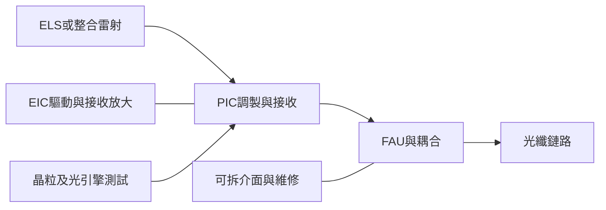

# 分析_光互連歷史紀要的架構與預測基線_20260812

## 問題背景

本批恢復三份5–8月歷史筆記，與11月供需預測相比可觀察估計如何變動。Notion建立日不等於原始內容日，且筆記包含單位與需求口徑矛盾。研究主張：保存歷史基線並核對預測誤差，不以舊筆記覆蓋最新資料或拼出一致共識。

## 關鍵發現

- [[memo_Notion_光通雷射元件供應鏈舊筆記_c699cdbc_20260509]]（正文更新2026-05-09；Notion日期8-23）區分資料調製光源、CW供光與EDFA泵浦，並列FBG、微透鏡、封裝及Paddle Card瓶頸；缺少每項第一手引據，供應角色需逐家公司驗證。
- [[memo_Notion_ScaleUp_CPO光源與FAU舊筆記_bd3fe2d7_20260618]]（正文2026-06-18；Notion日期8-23）以每GPU兩個OE／FAU、每四OE一個ELS建立用量情境，並描述主動對位、可拆FAU及晶圓級測試；這是指定架構模型，不能當所有平台BOM。
- [[memo_Notion_統一Coherent光模組供需紀要_3cefa765_20260812]]（正文明示2026-08-12）估2026北美800G約4,000萬、1.6T約1,000萬；2027約5,000萬–6,000萬與4,000萬–5,000萬。與11-02的2026 1.6T 1,700萬／2027 5,200萬–5,500萬不同，需先核對北美／全球及樣本日期。
- 同8-12紀要將NPO分為內置、外置ELS與VCSEL三類，並描述LTA「鎖產能、不完全鎖價」；不能僅由協議期限推定固定售價或不可撤銷收入。

## 投資重點 memo

| 重點 | 投資含義 | 相關標的 | 信心 |
|---|---|---|---|
| 歷史預測提供驗證基準 | 分開記錄採樣日、地區與需求／出貨，避免混用 | [[COHR.US(coherent)]]、[[技術_光模塊]] | thesis／中 |
| 光路與維修設計決定FAU／ELS用量 | 用平台BOM與插損／良率驗證，不直接套五倍用量 | [[NVDA.US(nvidia)]]、[[技術_FAU]] | 中低 |
| 光源與模組的毛利邊界不同 | 區分雷射die、封裝及完整ELS的實現收入 | [[LITE.US(lumentum)]]、[[COHR.US(coherent)]] | 中低 |

## 比較表

| 項目 | 歷史來源說法 | 應保留的邊界 |
|---|---|---|
| ELS 2028需求 | 8-12稱Coherent單家1,000萬支，又稱全市場1,000萬、Coherent 40%–50% | 同篇內部矛盾，不取平均或採較大數字 |
| EML價格 | Q2 US$5→7；另列200G DR US$13–15 | 產品、通道與封裝邊界未明，分開保存 |
| Coherent FY27產能 | 800G>2,000萬、1.6T 1,000萬–1,200萬 | 公司財年、產能與市場曆年出貨不是同一分母 |
| 六月光互連頻寬 | 7.2Tbps與7.2TBps交替使用 | 相差8倍；不採為固定跨層比率 |
| NPO光源 | 八月已有多路線，十月與十一月紀要各描述不同設計 | 按具體光路比較，不把NPO當單一BOM |

*圖：依六月文字重建功能層次；元件數、製程節點與是否可拆均依平台而異，不是原始投影片的重製。*

## Insight 結論

| 結論 | 投資含義 | 信心 |
|---|---|---|
| 留下歷史估計與錯誤能提高後續查詢品質 | 用時間序列驗證預測，不以數字出現次數當共識 | thesis／中 |

> [!tip] 結論／投資觀點
> 用相同年份、範圍與BOM追蹤合格交付；歷史架構筆記提供假設來源，尚未確認的供應商與需求倍數不轉成事實。

## 關鍵 Claim

| Claim | 類型 | 來源 | 日期 | 信心 |
|---|---|---|---|---|
| 2027北美1.6T約4,000萬–5,000萬支 | expert estimate，歷史預測 | [[memo_Notion_統一Coherent光模組供需紀要_3cefa765_20260812]] | 2026-08-12 | 低至中低 |
| 每GPU兩OE／FAU、0.5 ELS | 筆記模型，非通用BOM | [[memo_Notion_ScaleUp_CPO光源與FAU舊筆記_bd3fe2d7_20260618]] | 2026-06-18 | 低 |
| LTA可鎖產能但依條款調價 | 專家描述，依個別合約 | [[memo_Notion_統一Coherent光模組供需紀要_3cefa765_20260812]] | 2026-08-12 | 中低 |

> [!warning] 未讀附件與技術校正
> 六月筆記17張舊站圖均於2026-11-12回傳HTTP403，本地亦無同名檔；未能閱讀原圖，原連結完整保留於Raw，本頁以文字概念圖補位，不能聲稱看過投影片。其2026 NVL576／2028 Feynman路線、合作方及「光纖幾乎無損」「CPO減少O/E/O」為早期概括，不作現行平台規格；72×8為576，並非文中約500的精確值。
>
> 五月筆記EML應區分電吸收調製，非「電吸附」；WDCM／TDCM名稱、Paddle Card交期及台灣供應角色缺少原文件。八月紀要400mW CW良率20%–30%、InP晶圓可切數、供應商份額與單獨ELS指引均未獨立確認。

## 反證條件／待確認

> [!todo] 驗證與反證
> - [ ] 重新取得六月原投影片與17張圖，核對單位、平台及合作關係。
> - [ ] 確認八月ELS單家與全市場需求矛盾、FY／CY及產能／出貨的差異。
> - [ ] 依料號核對EML、CW與完整ELS價格及毛利。
> - [ ] 若客戶架構改變、單機用量降低或需求轉換不及預期，按歷史倍數估市場的thesis失效。

## 來源引用

- [[memo_Notion_光通雷射元件供應鏈舊筆記_c699cdbc_20260509]] — 正文2026-05-09，舊Wiki筆記轉存。
- [[memo_Notion_ScaleUp_CPO光源與FAU舊筆記_bd3fe2d7_20260618]] — 正文2026-06-18，17張圖片不可讀。
- [[memo_Notion_統一Coherent光模組供需紀要_3cefa765_20260812]] — 統一證券×COHR PM專家紀要，正文2026-08-12；均未外部查證。
