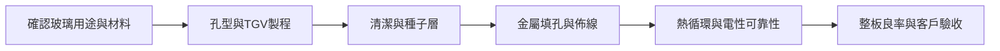

# 分析_玻璃基板應用邊界與TGV合格製程_20261002

## 問題背景

「玻璃基板」同時被用於暫時載具、永久核心與中介層，會造成市場規模與替代路徑混淆。來源提供TGV及金屬化的評估維度，但對BT、ABF與EMIB有概括或混寫。研究主張：先確認玻璃是否留在成品及承擔何種功能，再核對合格孔型、金屬化與量產良率。

## 關鍵發現

- [[memo_Notion_AceCamp_玻璃基板TGV與金屬化瓶頸_70567717_20261002]]（2026-10-02）區分Glass Carrier、Glass Core與玻璃中介層；Carrier可在製程後移除，因此其出貨不能等同永久玻璃核心滲透率。
- 同來源將TGV孔徑、深寬比、側壁粗糙度、孔距／密度及基板厚度列為聯合指標；不能只以最小孔徑展示圖判斷量產能力。
- 同來源描述雷射改質＋濕蝕刻、直接雷射鑽孔、乾蝕刻及光敏玻璃等路線，並強調玻璃材質／尺寸與化學處理需共同匹配。
- 同來源稱玻璃仍可搭配ABF增層膜，後續金屬化包含清潔、阻擋／種子層及填孔；「玻璃取代核心」不必然等於「ABF膜消失」。

## 延伸來源交叉檢查（2026-11-13）

| 來源與日期 | 新增資料點及衝突 | 類型／信心 |
|---|---|---|
| [[memo_Notion_AceCamp_CoPoS延後與CoWoS擴產推論_70564099_日期待確認]]；原日期見 Raw，未明者待確認 | 作者 CoPoS 2030Q4 推演與另篇最快 2029 不同；20 萬月產乘 12 為 240 萬，非 2027 年 200 萬。配圖將中介層與核心混層，不採定義。 | 訪談／作者 estimate，低至中；算術核對高 |
| [[memo_Notion_AceCamp_玻璃封裝三路線與製程_70561368_20260425]]；原日期見 Raw，未明者待確認 | 資料截止 2026-04-25 的綜合文稱 Clearwater 已於 2026-01 玻璃商用，與另一篇仍為原型／有機核心矛盾，不採已量產事實；LG Innotek 也不建成 LG Display 子公司。 | 訪談／作者 estimate，低至中；算術核對高 |
| [[memo_Notion_AceCamp_玻璃封裝時程與ABF邊界_70561996_日期待確認]]；原日期見 Raw，未明者待確認 | 作者圖中銅 CTE 7.8 與另一來源約 17 不一致，200:1 孔型與 10–15:1 的流程條件不同；14nm 以下必用 carrier／康寧獨供及 2035 TAM 均未有原始證明。 | 訪談／作者 estimate，低至中；算術核對高 |
| [[memo_Notion_AceCamp_玻璃Interposer與Core敘事邊界_70561067_20260421]]；原日期見 Raw，未明者待確認 | 2026-04-21 文章、資料截止 4/15：Carrier 暫時、Interposer／Core 永久的分層有用；CoPoS 為面板製程，不保證永久玻璃 TGV。圖中的『設備最確定』是作者 thesis，非量產訂單。 | 訪談／作者 estimate，低至中；算術核對高 |
| [[memo_Notion_AceCamp_玻璃GPU驗證與ABF增層_70560944_20260417]]；原日期見 Raw，未明者待確認 | 2026-04-17 材料廠經載板廠送測，無直接合作與實際採用；明述可用 ABF 膜 2／4／10／20 層增層，反駁 glass core 必消滅 ABF 的二分。種子層 PVD 與後續填孔須分開。 | 訪談／作者 estimate，低至中；算術核對高 |
| [[memo_Notion_AceCamp_TGV孔型金屬化與合格產能_70560941_20260417]]；原日期見 Raw，未明者待確認 | 2026-04-17 儲存本雖網址含 summary，實有多段完整問答，按提供內容保存。10 萬m² 為低密度 MicroLED 設計產能，不是多層 AI 封裝合格面積；無鹼指鹼金屬，不能與硼矽當互斥材料演進。 | 訪談／作者 estimate，低至中；算術核對高 |

這些補充不改寫較晚來源或原有結論。數字須先對齊產品、階段與分母，再用正式文件及實際交付驗證；不把重複轉述當獨立確認。

## 投資重點 memo

| 重點 | 投資含義 | 相關標的 | 信心 |
|---|---|---|---|
| Carrier、Core與Interposer屬不同市場 | 追蹤成品功能、單價及是否消耗，不用同一張數估值 | [[技術_玻璃基板]] | thesis／中 |
| TGV與金屬化需整合良率 | 以合格孔密度、導通可靠性及整板良率評估設備受惠 | [[技術_玻璃基板]]、[[INTC.US(intel)]] | 中低 |
| 尺寸與玻璃材質未收斂會延長驗證 | 裝置下單與量產收入分開 | [[技術_玻璃基板]] | 中低 |

## 比較表

| 名稱 | 玻璃是否留在成品 | 應追蹤的證據 |
|---|---|---|
| Glass Carrier | 通常移除 | 暫時鍵合／解鍵合良率、載具循環壽命 |
| Glass Core | 留在載板核心 | TGV、金屬化、CTE、翹曲與增層相容性 |
| 玻璃中介層 | 視封裝方案留存 | 重佈線、互連密度、封裝整合及客戶認證 |

*圖：本頁依來源整理的永久玻璃結構驗證鏈，Carrier不必經過所有TGV步驟。*

## Insight 結論

| 結論 | 投資含義 | 信心 |
|---|---|---|
| 「可鑽孔」距離「合格封裝」仍有多道轉換 | 投資判斷以整板可靠性與客戶驗收作終點 | thesis／中 |

> [!tip] 結論／投資觀點
> 先把用途、材料與製程整合對齊，再評估玻璃基板受惠；單一孔徑、展示樣品及Carrier收入不足以證明Glass Core放量。

## 關鍵 Claim

| Claim | 類型 | 來源 | 日期 | 信心 |
|---|---|---|---|---|
| 2027年中前選定方案、2028應用 | 匿名專家里程碑預測，非官方計畫 | [[memo_Notion_AceCamp_玻璃基板TGV與金屬化瓶頸_70567717_20261002]] | 2026-10-02 | 低 |
| 訪談樣本量產孔徑約50µm、深寬比約10:1 | expert estimate，非統一標準 | 同上 | 2026-10-02 | 低 |
| TGV需與金屬化及可靠性一起驗證 | 本頁thesis | 同上 | 2026-10-02 | 中 |

> [!warning] 定義與來源邊界
> 原文把BT核心、ABF膜與完整載板混稱，並將EMIB、矽通孔與中介層概括連結，不採為通用定義。其「CPO最快2028」、台積電／Intel先後順序及「所有大陸送樣不可信」均屬專家觀點，不能替代具名客戶資料。CTE數字未完整標示單位、尺寸公差依產品而異，不採作採購標準。

## 反證條件／待確認

> [!todo] 驗證與反證
> - [ ] 確認玻璃位於封裝哪一層、是否保留及是否仍使用ABF增層。
> - [ ] 核對孔徑與深寬比是否在同一材質、厚度、密度及量產良率下達成。
> - [ ] 核對具名客戶里程碑、設備驗收與實際出貨；不由面板加工經驗直接推定先進封裝資格。
> - [ ] 若有機核心改良足以滿足翹曲及密度，或金屬化可靠性未解，永久玻璃核心快速替代thesis失效。

## 來源引用

- [[memo_Notion_AceCamp_CoPoS延後與CoWoS擴產推論_70564099_日期待確認]] — 原日期未標；Notion 儲存本，未外部查證。
- [[memo_Notion_AceCamp_玻璃封裝三路線與製程_70561368_20260425]] — 2026-04-25；Notion 儲存本，未外部查證。
- [[memo_Notion_AceCamp_玻璃封裝時程與ABF邊界_70561996_日期待確認]] — 原日期未標；Notion 儲存本，未外部查證。
- [[memo_Notion_AceCamp_玻璃Interposer與Core敘事邊界_70561067_20260421]] — 2026-04-21；Notion 儲存本，未外部查證。
- [[memo_Notion_AceCamp_玻璃GPU驗證與ABF增層_70560944_20260417]] — 2026-04-17；Notion 儲存本，未外部查證。
- [[memo_Notion_AceCamp_TGV孔型金屬化與合格產能_70560941_20260417]] — 2026-04-17；Notion 儲存本，未外部查證。

- [[memo_Notion_AceCamp_玻璃基板TGV與金屬化瓶頸_70567717_20261002]] — AceCamp匿名專家，Notion日期2026-10-02，原訪談日未核。

## 相關頁面

- [[分析_Notion資料批次來源覆蓋與使用邊界_20261113]]
- [[分析_先進封裝材料的功能層與量產證據_20260719]]
- [[技術_ABF載板]]
- [[技術_CoWoS與先進封裝]]
- [[技術_PCB鑽孔設備]]
- [[時程_Notion歷史訪談的2026-2031驗證窗口_20261113]]
