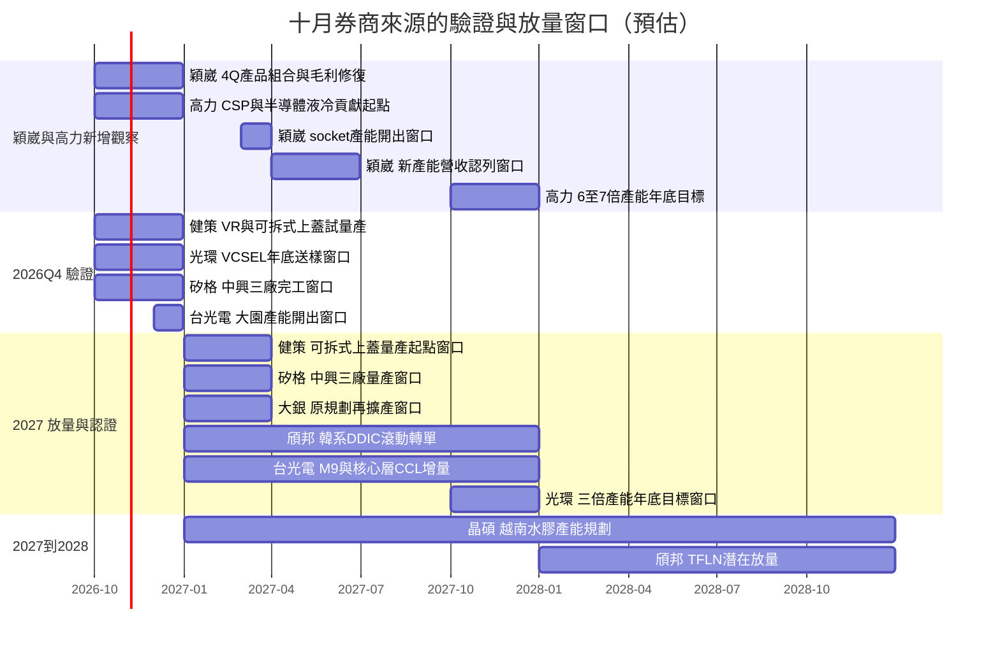
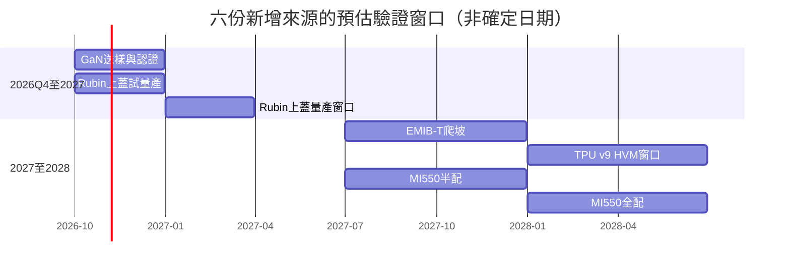

# 時程_2026-2028十月券商催化劑

## 日期表

本頁整理 2026-10-05～07 券商報告，**節點為來源轉述／預估，非統一公司公告時程**。產能、營收及設計導入分開追蹤；各公司頁保留來源內部差異。

| 日期 | 事件 | 相關公司 | 類型 | 重要性 | 來源與信心 |
|---|---|---|---|---|---|
| 2026Q4 | 探針卡交付減少後營收與毛利率分流（預估） | [[6515_穎崴（市）]] | 產品組合 | ⭐⭐⭐ | Citi／Daiwa 10/6 estimate、中；Daiwa 估營收持平至小幅季減、毛利率回升 |
| 2026Q4 起 | CSP CDU 與半導體設備液冷可能新增貢獻（預估） | [[8996_高力（市）]] | 放量 | ⭐⭐⭐ | [[報告_CLSA_SinoPac_高力_20261006]] thesis、中；未提供具名新訂單 |
| 2027-03→2027Q2 | 新增 socket 產能開出，再認列營收（預估） | [[6515_穎崴（市）]] | 擴產／放量 | ⭐⭐⭐ | [[報告_Daiwa_穎崴_20261006]] estimate、中；不等同原春針擴產計畫全數延期 |
| 2027 年底 | 高力產能目標為報告時 6–7 倍（預估） | [[8996_高力（市）]] | 擴產 | ⭐⭐⭐ | [[報告_CLSA_SinoPac_高力_20261006]] estimate、中；產品口徑與絕對產能未列 |
| 2026H2 | 可靠度重新認證後代工回流 | [[3234_光環（櫃）]] | 放量 | ⭐⭐⭐ | 第一金 10/5 轉述／中，客戶未具名 |
| 2026Q4 | VR 機櫃量產／可拆式上蓋擴大試量產（預估） | [[3653_健策（市）]] | 規格升級 | ⭐⭐⭐ | 凱基 10/7／中，不等同 MCL |
| 2026Q4 | 中興三廠完工（預估） | [[6257_矽格（市）]] | 放量 | ⭐⭐⭐ | 宏遠 10/7／中，設備交期影響爬坡 |
| 2026Q4 | 日本與歐洲需求延續（預估） | [[6491_晶碩（市）]] | 放量 | ⭐⭐ | 富邦 10/7／中，大溪新產能調適中 |
| 2026-12 | 大園新增產能預計開出 | [[2383_台光電（市）]] | 放量 | ⭐⭐ | 富邦 10/6／中；原文「30 張」單位未確認 |
| 2026 年底 | 1060nm VCSEL 提供客戶測試（預估） | [[3234_光環（櫃）]] | 驗證 | ⭐⭐ | 第一金 10/5／中，無具名設計導入 |
| 2027Q1 起 | 可拆式上蓋量產（預估） | [[3653_健策（市）]] | 放量 | ⭐⭐⭐ | 凱基 10/7／中；ASP／GPU 數量為模型假設 |
| 2027Q1 | 中興三廠量產（預估） | [[6257_矽格（市）]] | 放量 | ⭐⭐⭐ | 宏遠 10/7／中 |
| 2027Q1 | 原規劃定位平台產能再增 30% | [[4576_大銀微系統（市）]] | 放量 | ⭐⭐⭐ | 統一 10/7 轉述／中；券商模型僅採 22% |
| 2027Q1 起、至年底滾動 | 韓系百餘款 DDIC 委外（預估） | [[6147_頎邦（櫃）]] | 放量 | ⭐⭐⭐ | 凱基 10/7／中；客戶未具名，模型納 20 億元 |
| 2027 | 光通訊測試／切割逐步貢獻（預估） | [[6147_頎邦（櫃）]] | 放量 | ⭐⭐ | 凱基 10/7／中；設備投入不等同已完成驗證 |
| 2027 | M9 比重雙位數、ABF 核心層 CCL 增量（預估） | [[2383_台光電（市）]] | 規格升級／驗證 | ⭐⭐⭐ | 富邦 10/6／中；核心層 CCL 非 ABF 增層膜 |
| 2027 年底 | 產能估為 2026 年底 3 倍 | [[3234_光環（櫃）]] | 放量 | ⭐⭐⭐ | 第一金 10/5 estimate／中 |
| 2027→2028 | 越南水膠月產能規劃 1,000→2,000 萬片 | [[6491_晶碩（市）]] | 放量 | ⭐⭐⭐ | 富邦 10/7 轉述／中；不是已開出產能 |
| 2028 | TFLN 後段潛在有意義放量 | [[6147_頎邦（櫃）]] | 放量 | ⭐⭐ | 凱基 10/7 thesis／中低，未納入獲利模型 |

## Gantt 時程圖

季度／年度以區間呈現，區間端點只是圖表換算，不表示來源確認了確切日期。年底送樣用 Q4 窗口表達。

## 2026-09-14～10-01 六份新增來源的催化劑

以下為券商估計／參訪轉述。季度、年度與財年窗口依來源；HVM、送樣、良率、通電及收入不是同一節點。

| 日期／窗口 | 事件 | 相關公司 | 來源／類型與信心 |
|---|---|---|---|
| 2026-10→年底 | Gen5 GaN 樣品、客戶測試 | [[NVTS.US(navitas)]]、[[GFS.US(globalfoundries)]] | 國泰 p64–83，公司轉述／中 |
| 2026-10／年底 | 14A 0.9 PDK／18A 標準良率 | [[INTC.US(intel)]] | 國泰 p98–114，target／中；不是 foundry 已損平 |
| 2026-11 | Rubin 封測完整爬坡延後至11月 | [[NVDA.US(nvidia)]] | Aletheia channel_check／中低；與年內生產分開 |
| 2026Q4／2027Q1 | Rubin removable lid 試量產／量產；MI450 上蓋 Q4 量產 | [[3653_健策（市）]]、[[NVDA.US(nvidia)]]、[[AMD.US(amd)]] | JPM 9-29 estimate／中；與 MCL 不同 |
| 2026Q4／2027Q1 | v8t HVM／v9 tape-out 與初步結果 | [[2454_聯發科（市）]] | Aletheia estimate／中低；tape-out Q4、結果 Q1 |
| 2026 年底 | Sonoma 約 US$42m 訂單交付 | [[AEHR.US(aehr)]] | 國泰公司轉述／中，客戶未具名 |
| 2026 年底 | Claros 交易預定完成 | [[NVTS.US(navitas)]] | 國泰公司目標／中低；交易與收入分開 |
| FY3/27 H1／H2 | UPS／BBU 電池出貨窗口 | [[6762.JP(tdk)]] | GS company_comment／中 |
| FY27 | Gen5 GaN HVM／sidecar 訂單；原生 800V 至少一 XPU | [[NVTS.US(navitas)]]、[[GFS.US(globalfoundries)]]、[[2308_台達電（市）]]、[[2301_光寶科（市）]] | 國泰轉述／中；逐案認證未披露，不能當全面採用 |
| 2027 | HBF 送樣、NBM 合約供量與收款 | [[SNDK.US(sandisk)]] | 國泰 target／中；HBF 未納基準收入 |
| FY27 | 營收 US$130–150m 指引及 burn-in 交付 | [[AEHR.US(aehr)]] | 國泰 guidance轉述／中，財年結6月 |
| 2027 年底／2028 年底 | N3／N2／SoIC 擴產與 CoWoS 類供給 | [[2330_台積電（市）]] | JPM 9-30 estimate／中；詳公司表，口徑不與其他券商相加 |
| 2027H1 risk／2028H1 可能量產 | A14 製程 | [[2330_台積電（市）]] | JPM推測／中低，非官方承諾 |
| 2027H2／2028H1 | MI550 半配／全配 | [[AMD.US(amd)]] | Aletheia研究路線／中低，與早期MI500版本並列 |
| 2027H2／2028H1 | EMIB-T 爬坡／TPU v9 HVM | [[INTC.US(intel)]]、[[2454_聯發科（市）]] | 國泰／Aletheia轉述與estimate／中低；良率分母不同 |
| 2027Q4／2029H1 | Whalefish／Merope | [[AVGO.US(broadcom)]] | Aletheia estimate／中低 |
| FY27／FY28 | Duo 供給、記憶體成本／代理服務變現情境 | [[AAPL.US(apple)]] | MS 10-01 estimate／中；Siri收費未納基準 |
| FY28 最早 | HBM／HBF 測試導入選擇權 | [[AEHR.US(aehr)]] | 國泰公司估計／中低；目前未有收入 |
| 2028 | 14A HVM、GMI 日本初期約200MW計畫 | [[INTC.US(intel)]]、[[3231_緯創（市）]] | 國泰轉述／中低；前者與MS2029量產不同，後者合約／資金／通電未核對 |
| 2028／2029 | Claros VPD／IVR 收入、季度損平／OCF正值目標 | [[NVTS.US(navitas)]] | 國泰target／中低，不等於FY28全年獲利 |
| 2029+ | Icefish、HBM base die／NVLink內容值 | [[2454_聯發科（市）]] | Aletheia thesis／中低，需正式設計案 |

> [!warning] 時程分歧
> Intel來源摘要FY27 foundry損平與p111可能無法年底達成矛盾；14A的2028 HVM與舊MS2029 volume、原生800V與sidecar日期依不同來源並列。未建公司頁的太空／其他公司的里程碑留在 [[分析_國泰美國參訪_電力測試記憶體與太空驗證_20260914-18]]，不新增公司頁。

圖說：日期表示來源的季度／半年度窗口，沒有指定實際開始或完成日；條件與信心依表格。更遠年度與財年目標不畫成確切起訖。

## 相關頁面

- [[分析_2027加速器供電與ASIC價值移轉_20261001]]

- [[分析_BBU市場模型與電芯模組整合分工_20260924]]

- [[技術_800VDC供電架構]]

- [[6770_力積電（市）]]

- [[技術_矽光子（SiPh）]]、[[技術_TFLN]]、[[技術_光互連]]、[[技術_CCL]]。
- [[供應鏈_AI光互聯]]、[[供應鏈_工業自動化]]、[[供應鏈_醫療器材]]。

## 來源

- [[報告_高盛_BBU備援與峰值削減_20260924]] — Goldman Sachs，2026-09-24；原始研究／訪談全文，數字及時程依本批註記保留來源口徑。
- [[報告_Aletheia_2027AI加速器關鍵變化_20261001]] — Aletheia Capital，2026-10-01；原始研究／訪談全文，數字及時程依本批註記保留來源口徑。
- [[活動_國泰_美國參訪訪談紀要_20260914-18]] — 國泰證期研究部，2026-09-18；原始研究／訪談全文，數字及時程依本批註記保留來源口徑。
- [[報告_MorganStanley_Apple產品路線與估值_20261001]] — Morgan Stanley，2026-10-01；原始研究／訪談全文，數字及時程依本批註記保留來源口徑。
- [[報告_JPM_健策可拆式上蓋_20260929]] — J.P. Morgan，2026-09-29；原始研究／訪談全文，數字及時程依本批註記保留來源口徑。
- [[報告_JPM_台積電擴產與財測_20260930]] — J.P. Morgan，2026-09-30；原始研究／訪談全文，數字及時程依本批註記保留來源口徑。

- [[報告_Citi_穎崴_20261006]] — Citi，2026-10-06。
- [[報告_Daiwa_穎崴_20261006]] — Daiwa，2026-10-06。
- [[報告_CLSA_SinoPac_高力_20261006]] — SinoPac 研究／CLSA 分發，2026-10-06。
- [[報告_凱基_健策規格升級_20261007]] — 凱基投顧，2026-10-07。
- [[報告_凱基_頎邦光通訊與韓系轉單_20261007]] — 凱基投顧，2026-10-07。
- [[報告_富邦_台光電營運一路走高_20261006]] — 富邦投顧，2026-10-06。
- [[報告_富邦_晶碩營運動能無虞_20261007]] — 富邦投顧，2026-10-07。
- [[報告_第一金_光環光通訊與VCSEL_20261005]] — 第一金投顧，2026-10-05。
- [[報告_宏遠_矽格矽光子測試與擴產_20261007]] — 宏遠投顧，2026-10-07。
- [[報告_統一_大銀微系統精密定位_20261007]] — 統一投顧，2026-10-07。
