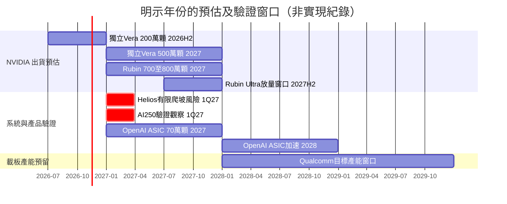

# 時程_2026-2029功率調價與AI平台驗證

## 日期表

來源：[[memo_使用者_Analog載板資料中心與AI晶片_日期待確認_收錄20261114]]（原日期未提供，2026-11-14 收錄）。全表為待驗證觀察／estimate／rumor，信心低至中低；日期已過亦不代表完成，未將收錄日當來源日。解讀及來源衝突見 [[分析_功率漲價與AI晶片出貨部署落差_日期待確認_收錄20261114]]。

| 日期 | 事件 | 相關公司 | 類型 | 重要性 | 備註 |
|---|---|---|---|---|---|
| 「本月」至「明年」（日期待確認） | 功率分離式元件分批調價 20–25% | [[TXN.US(texas_instruments)]]、[[IFX.DE(infineon)]] | 調價驗證 | ⭐⭐⭐ | rumor／低；未取得通知與料號；一般交期 12–16 週、經銷商可能 30 週 |
| 「今年夏季」起（日期待確認） | B300 交期接近 40 週並延續 | [[NVDA.US(nvidia)]] | 交付驗證 | ⭐⭐ | field_observation／低；未定起始年份，不畫入 Gantt |
| 未提供 | 鴻海生產問題據稱導致 Vera CPU 延後 | [[2317_鴻海（市）]]、[[NVDA.US(nvidia)]] | 交付風險 | ⭐⭐⭐ | rumor／低；無原交期或延後長度 |
| 2026H2（預估） | 獨立 Vera CPU 出貨 200 萬顆 | [[NVDA.US(nvidia)]] | 放量 | ⭐⭐⭐ | estimate／低；面向 Agent，不視為已實現 |
| 2026／2027（觀察） | GPU 部署落差、CPU 缺料與機房建置延期 | [[AMZN.US(amazon)]]、[[MSFT.US(microsoft)]] | 部署驗證 | ⭐⭐⭐ | 2026 全體 GPU 出貨／部署落差估 100 萬顆；範圍與期末存量未對齊 |
| 2027Q1（風險窗口） | Helios 爬坡可能非常有限並進一步延後 | [[AMD.US(amd)]] | 放量風險 | ⭐⭐⭐ | estimate／rumor／低；與 2026-11-04 法說轉述的先行出貨／放量展望分開 |
| 2027Q1（條件窗口） | AI250 驗證進展檢查；無進展才增加延期風險 | [[QCOM.US(qualcomm)]] | 驗證 | ⭐⭐⭐ | 不是正式量產或延期日期 |
| 2027（預估） | 獨立 Vera CPU 500 萬顆、Rubin GPU 700–800 萬顆 | [[NVDA.US(nvidia)]] | 放量 | ⭐⭐⭐ | 兩類晶片分開計；不與 die／rack 混算 |
| 2027H2（預估） | Vera Rubin Ultra 開始放量 | [[NVDA.US(nvidia)]] | 放量 | ⭐⭐⭐ | estimate／低；不覆蓋既有平台版本時程 |
| 2027（觀察） | Google／Meta 機房需求按原計畫、Meta ASIC 回升及 eSSD 強勁 | [[GOOGL.US(alphabet)]]、[[META.US(meta)]] | 需求驗證 | ⭐⭐ | field_observation／estimate／中低；無量化修正 |
| 2027／2028（預估） | OpenAI ASIC 2027 出貨 70 萬顆、2028 加速 | [[OpenAI（未）]] | 放量 | ⭐⭐⭐ | 與既有富邦 2027 需求 300 萬顆並列，未確認相同口徑 |
| 2028–2029（產能窗口） | Qualcomm 為 AI 載板預付 10–20 億美元的產能目標 | [[QCOM.US(qualcomm)]] | 產能驗證 | ⭐⭐⭐ | rumor／低；付款日期與收款方未知，不表示此時付款或保證投產 |

## Gantt 時程圖

圖說：季度／半年／年度的起迄僅為視覺化邊界，不是確定開工、首批出貨或驗證完成日；相對日期與未具名礦場改建不填造絕對日期。

## 來源

- [[memo_使用者_Analog載板資料中心與AI晶片_日期待確認_收錄20261114]] — 使用者提供，原日期未提供，收錄 2026-11-14。
- [[分析_功率漲價與AI晶片出貨部署落差_日期待確認_收錄20261114]] — 來源差異、分母檢查與反證條件。
