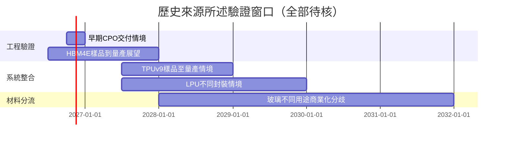

# 時程_Notion歷史訪談的2026-2031驗證窗口_20261113

本表保存本批歷史訪談的待驗證窗口。日期已過不代表里程碑完成；年份未明、原始會議日未標及匿名主體均保留限制，不以 Notion 建立日代替訪談日。公司欄以明示平台或研究技術頁連接，未確認供應商不建立定點關係。

## 日期表

| 日期 | 事件 | 相關公司／研究主題 | 類型 | 重要性 | 備註 |
|---|---|---|---|---|---|
| 2026Q4 | CPO 工程交付（預估） | [[NVDA.US(nvidia)]] | 驗證 | ⭐⭐⭐ | [[memo_Notion_AceCamp_CPO與NPO交付及價值分工_70562118_日期待確認]] 稱數千／1萬，2027 二十萬；日期未標，不視為已完成。 |
| 2027H2–2028 | LPU 獨立／整合封裝（情境） | [[NVDA.US(nvidia)]] | 技術下線 | ⭐⭐⭐ | [[memo_Notion_AceCamp_Feynman_LPU三種整合情境_70559280_日期待確認]] 作者稱 2027 獨立、2028–29 同封裝；非官方路線。 |
| 2026–2027 | Rubin HBM 與散熱整櫃驗收（待核） | [[NVDA.US(nvidia)]] | 放量 | ⭐⭐⭐ | [[memo_Notion_AceCamp_MI455X_Rubin驗證與交付_70562090_日期待確認]] 與 [[memo_Notion_AceCamp_Rubin排產與電源液冷資格_70560355_日期待確認]] 延遲說法相反，[[memo_Notion_AceCamp_GB300機櫃交付與延遲_70560558_20260406]] 機櫃數矛盾。 |
| 2026H2–2027 | HBM4E 樣品到量產（展望） | [[技術_HBM高頻寬記憶體]] | 規格升級 | ⭐⭐⭐ | [[memo_Notion_YahooFinance_SKhynix2026Q1法說_cecc08db_日期待確認]] 管理層轉錄，會議日未標；不涵蓋所有客戶。 |
| 2026–2027 | SST POC／sidecar（預估） | [[技術_800VDC供電架構]] | 驗證 | ⭐⭐ | [[memo_Notion_AceCamp_SST與Sidecar生態驗證_70563165_日期待確認]] 與 [[memo_Notion_AceCamp_HVDC儲能與SST架構_70563333_日期待確認]] 已出貨說法衝突，需對齊設備層級。 |
| 2026H2–2027初 | M10 板廠可靠性與接單（情境） | [[技術_CCL]] | 驗證 | ⭐⭐⭐ | [[memo_Notion_AceCamp_M9與M10樣品及材料供給_70561091_20260421]] 2026-04-21 訪談：送板後6–8週，不是已通過認證。 |
| 2027H2–2028 | TPUv9 樣品／量產（預估） | [[技術_AI推論與ASIC平台]] | 放量 | ⭐⭐⭐ | [[memo_Notion_AceCamp_TPU出貨與v9路線圖_70562074_日期待確認]] 與其他時程不同；預留產能不等當年交付。 |
| 2028後 | CPO 測試商業化（預估） | [[技術_矽光子（SiPh）]] | 驗證 | ⭐⭐ | [[memo_Notion_AceCamp_CPO電光測試與耗材壽命_70560925_20260416]] 2026-04-16，與早期工程交付須分開。 |
| 2028–2031 | CoPoS／glass core／interposer（分流情境） | [[技術_玻璃基板]] | 技術下線 | ⭐⭐⭐ | [[memo_Notion_AceCamp_玻璃封裝三路線與製程_70561368_20260425]]、[[memo_Notion_AceCamp_玻璃封裝時程與ABF邊界_70561996_日期待確認]]、[[memo_Notion_AceCamp_玻璃Interposer與Core敘事邊界_70561067_20260421]] 對已商用／原型及時程相反，非統一承諾。 |

## Gantt 時程圖

圖說：橫條表示各來源的預測區間，並非客戶確認的排程或實際完成率。

## 驗證與反證

- 先核對官方料號、工程樣、資格與量產，再核對整機驗收、收入與現金回收；同一名詞可能對應不同產品階段。
- 若架構改版、客戶延後、整板／整櫃良率未改善或名目產能無法轉合格交付，對應放量 thesis 需下修。
- 投資與衝突比較見 [[分析_加速器樣品到整櫃交付的驗證_日期待確認]]、[[分析_記憶體長約價格與合格位元供給驗證_日期待確認]]、[[分析_玻璃基板應用邊界與TGV合格製程_20261002]]。
